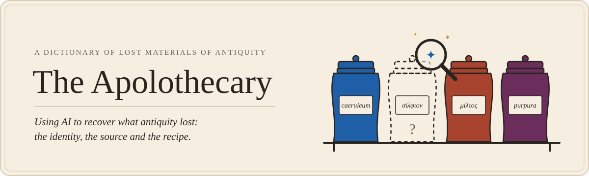
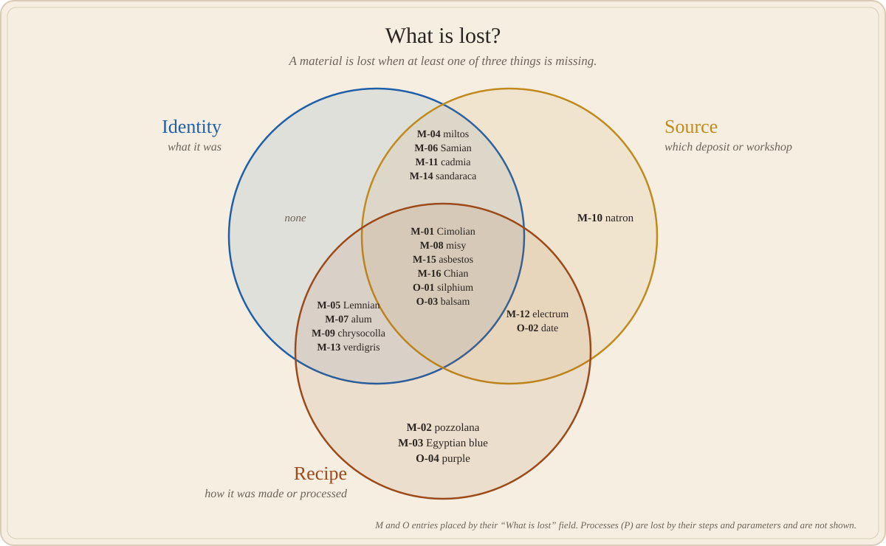

<p align="center">
  
</p>

# The Apolothecary

**A dictionary of lost materials of antiquity. Version 0.3 (21 November 2026).**
Based on the French draft *Dictionnaire des matériaux de l'Antiquité*. Every entry should be revisited against the critical editions and completed with laboratory data.

---

## Using AI to find lost things

Pliny, Theophrastus, Dioscorides and Vitruvius name earths, pigments, plants and recipes that can no longer be identified, located or made with certainty. The words survived; the things they named did not always survive with them.

An *apothecary* was first a storekeeper: the word comes, through Latin *apotheca*, from the Greek ἀποθήκη, "a place where things are put away" ([Wiktionary](https://en.wiktionary.org/wiki/apothecary)). The Apolothecary is a storehouse for what has been lost. Each entry is a jar with a label; the work is to find out what used to be inside.

The evidence is scattered. The Greek and Latin passages sit in several digitised corpora, the translations number their sections differently, and the modern identifications are spread across mineralogy, archaeometry, genetics and microbiology. Few specialists read all of it. This is where AI helps:

- **Search**: extract every occurrence of a term from the digitised corpora (TLG, PHI, Perseus, ToposText), including variant forms.
- **Connect**: line up each passage with the modern identifications and laboratory analyses that concern it.
- **Point**: show where the sources disagree, and which uncertain entries an experiment could settle.

AI is the search engine, not the authority. Every ancient passage it finds is checked against the critical edition before it earns a ✔, and every modern reference is checked for existence and bibliographic details (see [Status of references](#status-of-references)). A model that invents a citation creates one more lost thing.

The output is a list of questions a laboratory can answer: which Kimolos bentonite was the fuller's earth, whether the *santerna* solder can be rebuilt from Pliny's recipe, what the *misy* of the Cypriot mines was. See [Part V](#part-v).

---

## Contents

- [How to read this dictionary](#how-to-read)
- [The 28 entries at a glance](#at-a-glance)
- [Part I — Mineral materials (M)](#part-i)
- [Part II — Plant and animal materials (O)](#part-ii)
- [Part III — Methods and processes (P)](#part-iii)
- [Part IV — Candidates for future entries](#part-iv)
- [Part V — Method of work](#part-v)
- [Revision history](#revision-history)
- [About the figures](#about-the-figures)

---

<a id="how-to-read"></a>
## How to read this dictionary

### Purpose

Link each Greek or Latin technical term to (1) its occurrences in ancient texts, (2) the modern identifications that have been proposed, and (3) laboratory analyses, with an explicit degree of certainty. A material is "lost" here when at least one of three things is missing: its **identity** (what it was), its **source** (which deposit or workshop), or its **recipe** (how it was made or processed). This is a living work: each project adds or corrects entries.

<p align="center"></p>

### Scope

The dictionary has three sections, each with its own code:

- **M — Mineral materials**: earths, pigments, salts, alloys, binders.
- **O — Plant and animal materials**: plants, resins, dyes, foods, and the cultivated varieties they come from.
- **P — Methods and processes**: recipes, workshop operations, firing and transformation sequences. A process entry links to the M and O entries for the materials it uses.

For a plant, "lost" can also mean that the species or variety is extinct or unidentified. For a process, it means that steps or parameters (temperature, atmosphere, proportions, duration) are unknown.

<p align="center"></p>

### Entry structure (M and O)

| Field | Content |
|---|---|
| **Term** | Greek and Latin forms, variants |
| **Ancient sources** | Authors and passages |
| **Attested uses** | What the ancients did with it |
| **Provenance** | Places named in the sources |
| **Proposed identifications** | Modern hypotheses, with their authors |
| **Analyses** | Archaeological or reference samples, methods (XRD, spectroscopy, microscopy, microbiology) |
| **What is lost** | Identity, source, recipe, or several of these |
| **Certainty** | High / Medium / Low / Unknown |
| **Open questions** | What remains to be done; possible project |
| **Key references** | Verified modern literature |

### Certainty scale (M and O; see Part III for processes)

-  **High**: identification confirmed by analysed ancient samples *and* by coherent texts.
-  **Medium**: hypothesis supported by mineralogy or provenance, without direct confirmation on ancient material.
-  **Low**: several competing hypotheses, or a term that probably covers different materials.
-  **Unknown**: no serious identification.

<a id="status-of-references"></a>
### Status of references (important)

- **Modern references** were checked one by one for existence, authors, year, journal, volume, pages and DOI (via publisher pages, DOIs or library catalogues). Claims attributed to them come from their abstracts or the publishers' summaries. **Full texts have not all been read.** Re-read each paper before citing it in a publication.
- **Ancient passages** marked ✔ were checked against a published citation. Those marked *(to be confirmed)* are given at book level, or with section numbers that must still be checked against the critical edition (step 2 of the method). Section numbering differs between the Bostock & Riley translation and modern editions of Pliny (Loeb, Budé).

### Reference editions and tools for the primary sources

- **Theophrastus**, *On Stones*: E. R. Caley & J. F. C. Richards, *Theophrastus on Stones: Introduction, Greek Text, English Translation, and Commentary*. Columbus: The Ohio State University, 1956 (Graduate School Monographs, Contributions in Physical Science 1). An open-access text is available from Ohio State University Press.
- **Pliny the Elder**, *Natural History*, chemical and mineralogical books: K. C. Bailey, *The Elder Pliny's Chapters on Chemical Subjects*, 2 vols. London: Edward Arnold, 1929–1932. This gives an edited text, translation and notes.
- **Leiden and Stockholm papyri**: R. Halleux (ed., trans.), *Les Alchimistes grecs, tome I: Papyrus de Leyde, Papyrus de Stockholm, Fragments de recettes*. Paris: Les Belles Lettres (Collection des universités de France), 1981. This is the reference edition. It made the Berthelot–Ruelle *Collection des anciens alchimistes grecs* (1887–1888) obsolete.
- **Dioscorides**, *De materia medica* book V (minerals), and **Vitruvius**, *De architectura*: use the critical editions (Wellmann for Dioscorides; Budé or Teubner for Vitruvius). These are still to be added to the bibliography.

---

<a id="at-a-glance"></a>
## The 28 entries at a glance

Certainty as given in each entry. Click a code to jump to it.

| Code | Entry | What is lost | Certainty |
|---|---|---|---|
| [M-01](#m-01) | Cimolian earth | source; processing |  |
| [M-02](#m-02) | Pozzolana | exact recipe |  |
| [M-03](#m-03) | Egyptian blue | recipe; why it disappeared |  |
| [M-04](#m-04) | Miltos and sinopis | how to tell the varieties apart |  family ·  varieties |
| [M-05](#m-05) | Lemnian earth | processing recipe; ancient composition |  processed clay ·  active ingredient |
| [M-06](#m-06) | Samian earth | identity; deposit |  to  |
| [M-07](#m-07) | Alum | the range of products sold under one name |  |
| [M-08](#m-08) | Misy | identity; recipe for use |  |
| [M-09](#m-09) | Chrysocolla | identity; recipe |  |
| [M-10](#m-10) | Natron | map of sources; why the supply declined |  |
| [M-11](#m-11) | Cadmia | natural versus furnace *cadmia* in each text |  |
| [M-12](#m-12) | Electrum | the economics of refining |  |
| [M-13](#m-13) | Verdigris | which product each recipe made |  |
| [M-14](#m-14) | Orpiment and sandaraca | the meaning of *sandaraca* in each author |  *auripigmentum* ·  *sandaraca* |
| [M-15](#m-15) | Asbestos | sources; spinning technique |  family |
| [M-16](#m-16) | Chian earth | stub: passages still to collect |  |
| [O-01](#o-01) | Silphium | identity; source; harvesting of the resin |  identity ·  species |
| [O-02](#o-02) | Judean date | the varieties; cultivation practices |  |
| [O-03](#o-03) | Judean balsam | species; variety; tapping and refining |  |
| [O-04](#o-04) | Tyrian purple | the vat process; quality grades |  chemistry ·  process |
| [P-01](#p-01) | Hot mixing of lime mortars | proportions, water, placing, timing |  |
| [P-02](#p-02) | Attic black gloss | slip preparation; firing schedule; atmosphere control |  to  |
| [P-03](#p-03) | Natron glass in tank furnaces | furnace parameters; batch formulation |  to  |
| [P-04](#p-04) | Egyptian embalming | full recipes; order of operations; variation |  |
| [P-05](#p-05) | Encaustic and Punic wax | Punic wax preparation; tools and temperatures |  |
| [P-06](#p-06) | Garum and fish sauces | salt ratio; fermentation time; additives |  |
| [P-07](#p-07) | Gold refining by cementation | reconstructed by Ramage & Craddock (2000) |  |
| [P-08](#p-08) | Synthesis of Egyptian blue | proportions; firing cycle |  to  |

Lists of terms still to investigate: [O-05](#o-05) (plants and animals), [P-09](#p-09) (processes), [Part IV](#part-iv).

---

<a id="part-i"></a>
##  Part I — Mineral materials (M)
<br clear="left">

<a id="m-01"></a>
### M-01. Cimolia — Cimolian earth (κιμωλία γῆ; *creta cimolia*)

- **Ancient sources**: Theophrastus, *On Stones*; Pliny, *NH* book 35; Dioscorides book V *(passages to be confirmed)*. It is also mentioned in Aristophanes' *Frogs* (c. 405 BC) as a washing earth *(to be confirmed against the edition)*.
- **Attested uses**: fulling and cleaning cloth; medicinal uses.
- **Provenance**: Kimolos, Cyclades, north-east of Melos.
- **Proposed identifications**: a smectitic clay (bentonite / Ca-montmorillonite) of the fuller's-earth type. Robertson's history of fuller's earth treats the ancient earths as calcium montmorillonite. Some secondary sources also compare it to kaolin.
- **Analyses**: no analysis of an *ancient* sample of Cimolian earth has been found so far. The geology is well documented. Christidis showed that the Kimolos bentonites formed by low-temperature alteration of rhyolitic rocks, producing montmorillonite and, in some zones, mordenite. He also measured the physical and chemical properties (rheology, swelling) of several Kimolos deposits, and studied the origin of the white colour of the Milos and Kimolos bentonites.
- **What is lost**: source (which deposit) and processing.
- **Certainty**: **Medium**.
- **Open questions**: Which deposit on the island was worked in antiquity? What was its composition? Why was it preferred to other earths? One method would compare the cleaning performance of the different Kimolos bentonite grades (white versus coloured; with or without mordenite) using a fulling test on wool. **Possible pilot project**, with the archaeologist.
- **Key references**:
  - Robertson, R. H. S. (1986). *Fuller's Earth: A History of Calcium Montmorillonite*. London.
  - Christidis, G. E. (1998). Physical and chemical properties of some bentonite deposits of Kimolos Island, Greece. *Applied Clay Science* 13(2): 79–98. doi:10.1016/S0169-1317(98)00023-4
  - Christidis, G. E. (2001). Formation and growth of smectites in bentonites: a case study from Kimolos Island, Aegean, Greece. *Clays and Clay Minerals* 49(3): 204–215. doi:10.1346/CCMN.2001.0490303
  - Christidis, G. E. & Scott, P. W. (1997). The origin and control of colour of white bentonites from the Aegean islands of Milos and Kimolos, Greece. *Mineralium Deposita* 32(3): 271–279. doi:10.1007/s001260050092

---

<a id="m-02"></a>
### M-02. Pulvis puteolanus — pozzolana

- **Ancient sources**: Vitruvius, *De architectura* book 2 *(chapter to be confirmed)*; Pliny, *NH* 35.166 ✔ (volcanic ash that becomes a single stone mass in the sea).
- **Attested uses**: hydraulic binder for concrete, including marine structures (harbours, breakwaters).
- **Provenance**: Bay of Naples, around Puteoli (Pozzuoli); mainly ash from the Campi Flegrei.
- **Identification**: reactive (zeolitised) volcanic ash, mixed with lime.
- **Analyses**:
  - Jackson et al. (2017) studied cores from Roman harbour structures. They used synchrotron X-ray microdiffraction. They found Al-tobermorite and phillipsite that crystallised from low-temperature water–rock reactions, inside pumice clasts, dissolved feldspars and the pores of the matrix.
  - Seymour et al. (2023) studied the lime clasts using multiscale elemental and chemical mapping. They argue that the Romans used "hot mixing" with quicklime, and that these clasts act as a reserve of reactive calcium that can fill cracks (self-healing).
- **What is lost**: the exact recipe (proportions, quicklime or slaked lime, how the mix was placed).
- **Certainty**: **High**.
- **Open questions**: reproduce mixes from the textual recipes (Vitruvius, Pliny), then test their durability in seawater.
- **Key references**:
  - Jackson, M. D., Mulcahy, S. R., Chen, H., Li, Y., Li, Q., Cappelletti, P. & Wenk, H.-R. (2017). Phillipsite and Al-tobermorite mineral cements produced through low-temperature water-rock reactions in Roman marine concrete. *American Mineralogist* 102(7): 1435–1450. doi:10.2138/am-2017-5993CCBY (open access)
  - Seymour, L. M., Maragh, J., Sabatini, P., Di Tommaso, M., Weaver, J. C. & Masic, A. (2023). Hot mixing: Mechanistic insights into the durability of ancient Roman concrete. *Science Advances* 9(1): eadd1602. doi:10.1126/sciadv.add1602

---

<a id="m-03"></a>
### M-03. Caeruleum — Egyptian blue (κύανος; *caeruleum*)

- **Ancient sources**: Vitruvius 7.11 (manufacture of *caeruleum*, attributed to Vestorius at Puteoli) *(to be confirmed)*; Theophrastus, *On Stones* (κύανος) *(section to be confirmed)*; Pliny, *NH* book 33.
- **Attested uses**: pigment (wall painting, polychrome sculpture).
- **Identification**: calcium copper tetrasilicate CaCuSi₄O₁₀, the same structure as the mineral cuprorivaite. This is the first synthetic pigment, used from about 2600 BC. Pabst (1959) solved its crystal structure, a tetragonal sheet silicate.
- **Analyses**: Egyptian blue gives an exceptionally strong near-infrared luminescence (maximum around 910 nm, quantum yield about 10.5%, lifetime about 107 µs; Accorsi et al. 2009). Museum imaging uses this to detect it without contact. Bulk CaCuSi₄O₁₀ also splits into monolayer nanosheets in hot water (Johnson-McDaniel et al. 2013). This has led to proposed uses in near-infrared biomedical imaging and security inks.
- **What is lost**: the ancient recipe in detail (raw materials, firing cycle) and the reason the pigment disappeared after antiquity.
- **Certainty**: **High**.
- **Open questions**: compare the ancient recipes with the procedures recovered by experimental archaeology; trace production centres from trace elements.
- **Key references**:
  - Pabst, A. (1959). Structures of some tetragonal sheet silicates. *Acta Crystallographica* 12: 733–739.
  - Accorsi, G., Verri, G., Bolognesi, M., Armaroli, N., Clementi, C., Miliani, C. & Romani, A. (2009). The exceptional near-infrared luminescence properties of cuprorivaite (Egyptian blue). *Chemical Communications* 2009(23): 3392–3394. doi:10.1039/b902563d
  - Johnson-McDaniel, D., Barrett, C. A., Sharafi, A. & Salguero, T. T. (2013). Nanoscience of an ancient pigment. *Journal of the American Chemical Society* 135(5): 1677–1679. doi:10.1021/ja310587c

---

<a id="m-04"></a>
### M-04. Miltos and sinopis — red earths (μίλτος; *rubrica*, *sinopis*)

- **Ancient sources**: Theophrastus, *On Stones*; Pliny, *NH* books 33 and 35 *(sections to be confirmed)*.
- **Attested uses**: pigment, marking, ship maintenance, agriculture, medicine.
- **Provenance**: Sinope, Lemnos, Kea.
- **Identification**: red ochres based on iron oxide (hematite).
- **Analyses**: Photos-Jones et al. (1997) described the Kea *miltos* as "the well-known iron oxides of antiquity". Photos-Jones et al. (2018) analysed geological samples from Kea and an archaeological sample. They studied the mineral together with its microbiome and its nanoparticles, to explain its medicinal use.
- **What is lost**: how to tell the varieties apart (Sinopic, Lemnian, Kean) and how each market judged their quality.
- **Certainty**: **High** for the family; **Medium** for the varieties.
- **Open questions**: tell provenances apart by their geochemical signatures (trace elements, isotopes) on dated archaeological pigments.
- **Key references**:
  - Photos-Jones, E., Cottier, A., Hall, A. J. & Mendoni, L. G. (1997). Kean miltos: the well-known iron oxides of antiquity. *Annual of the British School at Athens* 92: 359–371.
  - Photos-Jones, E., Knapp, C. W., Venieri, D., Christidis, G. E., Elgy, C., Valsami-Jones, E., Gounaki, I. & Andriopoulou, N. C. (2018). Greco-Roman mineral (litho)therapeutics and their relationship to their microbiome: the case of the red pigment miltos. *Journal of Archaeological Science: Reports* 22: 179–192. doi:10.1016/j.jasrep.2018.07.017

---

<a id="m-05"></a>
### M-05. Lemnian earth — sphragis (Λημνία γῆ, σφραγίς; *terra Lemnia*, *terra sigillata*)

- **Ancient sources**: Dioscorides book V; Galen *(passages to be confirmed)*. Galen went to Lemnos in AD 167 and is said to have brought back twenty thousand *sphragides* for his patients.
- **Attested uses**: medicinal (antidote to poison, wounds), sold as sealed tablets stamped by a priestess. It was used from Classical or Hellenistic times until the early 20th century.
- **Provenance**: Lemnos. Altered volcanic rocks near Kotsinas (north-east Lemnos) are the most likely source.
- **Proposed identifications**:
  - Klaproth and other 19th-century chemists found only a silicate clay.
  - Hall & Photos-Jones (2008) argue that Lemnian earth the *artefact* was not the same as Lemnian earth the *raw material*. They suggest it was a processed clay, possibly enriched in alum (astringent).
- **Analyses** (on **16th–18th century** sphragides, not ancient ones):
  - Photos-Jones et al. (2017): three Lemnian sphragides in Basel had a significant antibacterial effect against *Staphylococcus aureus*; the modern clays had none.
  - Christidis et al. (2020): a fungus, *Talaromyces* spp. (historically associated with *Penicillium*), was found in two of the three Lemnian earths. The antibacterial activity seems to be driven by this fungal component. Historical evidence suggests the fungus may have been added on purpose.
- **What is lost**: the processing recipe (rite and technique), and the exact composition of the *ancient* product.
- **Certainty**: **Medium** for "processed clay"; **Low** for the active ingredient (alum, fungus, or both).
- **Open questions**: find and analyse sphragides from antiquity; test an experimental reconstruction of the processing described in the texts (washing, settling, choosing the top layer).
- **Key references**:
  - Hall, A. J. & Photos-Jones, E. (2008). Accessing past beliefs and practices: the case of Lemnian Earth. *Archaeometry* 50(6): 1034–1049. doi:10.1111/j.1475-4754.2007.00377.x
  - Photos-Jones, E. & Hall, A. J. (2011). *Lemnian Earth and the Earths of the Aegean: An Archaeological Guide to Medicines, Pigments and Washing Powders*. Glasgow: Potingair Press. ISBN 9780956824004
  - Photos-Jones, E. & Hall, A. J. (2014). Lemnian Earth, alum and astringency: a field based approach. In: Michaelides, D. (ed.), *Medicine and Healing in the Ancient Mediterranean World*. Oxford: Oxbow, pp. 183–189.
  - Photos-Jones, E., Edwards, C., Häner, F., Lawton, L., Keane, C., Leanord, A. & Perdikatsis, V. (2017). Archaeological medicinal earths as antibacterial agents: the case of the Basel Lemnian sphragides. In: *Geology and Medicine: Historical Connections*, Geological Society, London, Special Publications 452: 141–153.
  - Christidis, G. E., Knapp, C. W., Venieri, D., Gounaki, I., Elgy, C., Valsami-Jones, E. & Photos-Jones, E. (2020). The interweaving roles of mineral and microbiome in shaping the antibacterial activity of archaeological medicinal clays. *Journal of Ethnopharmacology* 260: 112894. doi:10.1016/j.jep.2020.112894
  - Venieri, D., Gounaki, I., Christidis, G. E., Knapp, C. W., Bouras-Vallianatos, P. & Photos-Jones, E. (2020). Bridging the gaps: Bole and Terra Sigillata as artefacts, as simples and as antibacterial clays. *Minerals* 10(4): 348.

---

<a id="m-06"></a>
### M-06. Samian earth (Σαμία γῆ; *terra Samia*)

*(From the draft's "terms to investigate".)*

- **Ancient sources**: Dioscorides book V *(passage to be confirmed)*.
- **Attested uses**: eye salve, cleaning cloth.
- **Provenance**: Samos (eastern Aegean).
- **Proposed identifications**: traditionally equated with kaolin. Photos-Jones et al. (2015) instead suggest a composition linked to local **borates** found near bentonitic clays.
- **Analyses**: antibacterial tests on clays from Samos (Photos-Jones et al. 2015). Clays spiked with boron or aluminium do become antibacterial (Christidis et al. 2020).
- **What is lost**: identity (kaolin, or bentonite with borates) and the deposit.
- **Certainty**: **Low to medium**.
- **Open questions**: look for boron in archaeological samples; compare with the description of the "aster" and "collyrium" varieties.
- **Key references**:
  - Photos-Jones, E., Keane, C., Jones, A. X., Stamatakis, M., Robertson, P., Hall, A. J. & Leanord, A. (2015). Testing Dioscorides' medicinal clays for their antibacterial properties: the case of Samian Earth. *Journal of Archaeological Science* 57: 257–267. doi:10.1016/j.jas.2015.01.020

---

<a id="m-07"></a>
### M-07. Alumen and stypteria — alum (στυπτηρία; *alumen*)

*(Listed among the "terms to investigate"; promoted to an entry.)*

- **Ancient sources**: Pliny, *NH* book 35; Dioscorides book V *(sections to be confirmed)*. Pliny describes a purity test with pomegranate juice, which is a very sensitive test for dissolved iron sulphate (about 40 ppm, according to the Glasgow team).
- **Attested uses**: textiles (mordant), tanning, metallurgy, medicine (astringent).
- **Provenance**: Melos, Campi Flegrei (Naples), among other places.
- **Identification**: mainly aluminium sulphates, notably solfataric alum efflorescences. These are not necessarily the potassium alum of modern chemistry.
- **Analyses**: Photos-Jones et al. (2016) show that at Campi Flegrei and on Melos, solfataric alum was extracted and then processed by dissolution and evaporation, using geothermal energy at temperatures not exceeding 100 °C. The product appears strongly antibacterial.
- **What is lost**: the range of products sold under one name, and the form in which they were traded.
- **Certainty**: **Medium** (a well-defined chemical family, but a commercial term that covers several products).
- **Open questions**: link residues found in amphorae or workshops to sources; replicate Pliny's grading tests.
- **Key references**:
  - Photos-Jones, E., Christidis, G. E., Piochi, M., Keane, C., Mormone, A., Balassone, G., Perdikatsis, V. & Leanord, A. (2016). Testing Greco-Roman medicinal minerals: the case of solfataric alum. *Journal of Archaeological Science: Reports* 10: 82–95. doi:10.1016/j.jasrep.2016.08.042
  - Photos-Jones, E. & Christidis, G. E. (2022). Solfataric alum exploitation during the Greco-Roman period: some considerations on its nature, enrichment, and preparation for market. Heidelberg: Propylaeum, pp. 19–33. doi:10.11588/propylaeum.896.c11644 *(title of the edited volume to be added)*

---

<a id="m-08"></a>
### M-08. Misy (μίσυ; *misy*)

- **Ancient sources**: Dioscorides book V; Pliny, *NH* book 34; Galen (who visited the mines at Soloi in Cyprus) *(passages to be confirmed)*. It belongs to the "vitriolic" group with *chalcitis*, *sory* and *melanteria*.
- **Attested uses**: medicine, metallurgy (gold-parting cements).
- **Proposed identification**: iron and copper sulphates formed by the weathering of sulphide ores, probably a natural mixture of several minerals.
- **Analyses**: no analysis of an ancient sample found. Experimental archaeology has reproduced gold-parting cements containing *misy*, following Galen, Dioscorides and Agricola (Celauro et al., 2017; *full reference to be added*). A 2024 study (*RSC Advances*) on medieval vitriols shows how hard it is to match historical names to modern minerals.
- **What is lost**: identity (a generic term or a precise mineral) and the recipe for use.
- **Certainty**: **Low**.
- **Open questions**: is it a generic term or a single mineral? Sample the weathering zones of the Cypriot mines (Soloi, Skouriotissa) and compare them with the descriptions (colour, "golden" crystallisation, behaviour when heated).
- **Key references**: to be compiled. Starting points: Bailey (1929–1932) for Pliny's text; Hoover & Hoover's notes to Agricola, *De re metallica* (1912), appendix on ancient authors.

---

<a id="m-09"></a>
### M-09. Chrysocolla (χρυσόκολλα; *chrysocolla*, *santerna*)

- **Ancient sources**: Pliny, *NH* book 33 (several chapters: natural chrysocolla, artificial chrysocolla, the goldsmiths' chrysocolla or *santerna*); Theophrastus, *On Stones* (κυανὸς … ἔχων ἐν ἑαυτῷ χρυσοκόλλαν) *(section to be confirmed)*; Leiden papyrus X, recipe 31 according to secondary sources *(to be confirmed in Halleux 1981)*.
- **Attested uses**: soldering gold; green pigment.
- **Identification**: ambiguous. The word probably covers several substances:
  1. green copper minerals or salts (malachite and similar);
  2. the goldsmiths' solder (*santerna*). Pliny gives a recipe based on verdigris of Cyprian copper, urine and *nitrum*;
  3. possibly a cadmium sulphide. Demortier found cadmium (up to several per cent) in solders on ancient gold objects from Iran and Syria, and proposed that the goldsmiths' chrysocolla could be greenockite rather than malachite.

  It does not necessarily correspond to the modern mineral chrysocolla (a hydrated copper silicate).
- **What is lost**: identity and recipe.
- **Certainty**: **Low**.
- **Open questions**: reconstruct the *santerna* solder from Pliny's recipe and test it (colloidal hard soldering by reduction of copper salts); look for cadmium systematically in the joins of dated gold work.
- **Key references**:
  - Demortier, G. (1987). La chrysocolle des orfèvres est-elle jaune ? *Archaeometry* 29(2): 275–288.
  - Demortier, G. Ancient gold solders: what was chrysocolla? (*conference paper, pp. 249–263; full reference to be completed*).

---

<a id="m-10"></a>
### M-10. Nitrum — natron (νίτρον; *nitrum*)

- **Ancient sources**: Pliny, *NH* book 31 *(sections to be confirmed; c. 31.106–122)*.
- **Attested uses**: glass, cleaning, mummification, metallurgy, medicine.
- **Provenance**: Egypt (Wadi Natrun, al-Barnuj), among other places.
- **Identification**: natural sodium carbonates (trona, natron) mixed with sulphates and chlorides.
- **Analyses**: Shortland et al. (2006) give the outline of its history. Natron was used only occasionally in the 4th millennium BC for glazes. It became the flux of glass from around the start of the 1st millennium BC. By the 5th century BC it was the flux of most glass west of the Euphrates. It then declined after late antiquity, when plant ash returned. Boron is being studied as a tracer for the provenance of deposits.
- **What is lost**: little as regards identity; mainly the *map of sources* and the reasons the supply declined.
- **Certainty**: **High**.
- **Key references**:
  - Shortland, A., Schachner, L., Freestone, I. & Tite, M. (2006). Natron as a flux in the early vitreous materials industry: sources, beginnings and reasons for decline. *Journal of Archaeological Science* 33: 521–530.
  - Rehren, Th. & Freestone, I. C. (2015). Ancient glass: from kaleidoscope to crystal ball. *Journal of Archaeological Science* 56: 233–241.

---

<a id="m-11"></a>
### M-11. Cadmia (καδμεία; *cadmea*, *cadmia*)

*(Term to investigate; first entry.)*

- **Ancient sources**: Dioscorides book V; Pliny, *NH* book 34 *(passages to be confirmed)*.
- **Attested uses**: making brass (cementation with copper), medicine.
- **Identification**: zinc ores (calamine, smithsonite) **and** zinc oxide deposits collected in furnaces. This is a term with at least two meanings.
- **Analyses**: intentional brass production appears in the 1st millennium BC, probably in Asia Minor. By the 3rd century AD, about a third of Roman copper alloys were brasses (Craddock 1978). In the Roman world, brass was mainly made by cementation.
- **What is lost**: the boundary between natural *cadmia* and furnace *cadmia* in each text.
- **Certainty**: **Medium**.
- **Key references**:
  - Craddock, P. T. (1978). The composition of the copper alloys used by the Greek, Etruscan and Roman civilizations. 3. The origins and early use of brass. *Journal of Archaeological Science* 5(1): 1–16.
  - Craddock, P. T. (ed.) (1998). *2000 Years of Zinc and Brass*, rev. ed. British Museum Occasional Paper 50. London.

---

<a id="m-12"></a>
### M-12. Electrum (ἤλεκτρον; *electrum*)

*(Term to investigate; first entry.)*

- **Ancient sources**: Pliny, *NH* book 33 *(to be confirmed)*; Herodotus on Lydia.
- **Attested uses**: the first coinage (Lydia), goldsmith work.
- **Provenance**: Pactolus (Sardis, Lydia), the alluvial gold-bearing sands.
- **Identification**: a natural gold–silver alloy. Note that the Greek ἤλεκτρον also means amber; the context decides.
- **Analyses**: excavations of the gold refinery at Pactolus North (Sardis) and the reconstruction of the refining process (cementation with salt) are described in Ramage & Craddock (2000).
- **What is lost**: little for the identity; much for the economics of refining.
- **Certainty**: **High**.
- **Key references**:
  - Ramage, A. & Craddock, P. T. (2000). *King Croesus' Gold: Excavations at Sardis and the History of Gold Refining*. Archaeological Exploration of Sardis 11. Cambridge, MA: Harvard University Art Museums / London: British Museum Press.

---

<a id="m-13"></a>
### M-13. Aerugo — verdigris (ἰός; *aerugo*, *aeris flos*)

*(Term to investigate; first entry.)*

- **Ancient sources**: Pliny, *NH* book 34; Dioscorides book V; Vitruvius book 7 *(passages to be confirmed)*.
- **Attested uses**: green pigment, medicine, an ingredient of the *santerna* solder (see M-09).
- **Identification**: copper acetates (neutral and basic). The term probably also covers other copper corrosion products (carbonates, chlorides) depending on the recipe.
- **Analyses**: Scott (2002) is the standard reference on the chemistry and history of verdigris and the early recipes.
- **What is lost**: which product each ancient recipe actually made.
- **Certainty**: **Medium**.
- **Open questions**: reproduce the recipes (copper plates exposed to grape marc or vinegar) and identify the products by XRD and Raman spectroscopy.
- **Key references**:
  - Scott, D. A. (2002). *Copper and Bronze in Art: Corrosion, Colorants, Conservation*. Los Angeles: Getty Conservation Institute. ISBN 0-89236-638-9 (free online from the Getty).

---

<a id="m-14"></a>
### M-14. Auripigmentum and sandaraca — arsenic sulphides (ἀρσενικόν, σανδαράκη)

*(Terms to investigate; first entry.)*

- **Ancient sources**: Theophrastus, *On Stones* (σανδαράκη and ἀρρενικόν appear together, with other "dry and smoky exhalation" minerals) ✔ via the Caley & Richards Greek text; Vitruvius book 7; Pliny, *NH* books 34–35 *(sections to be confirmed)*.
- **Attested uses**: yellow and red-orange pigments, medicine.
- **Provenance**: Pontus (best *sandaraca*, according to Vitruvius), the Red Sea region (Pliny), among other places.
- **Identification**: *auripigmentum* is orpiment (As₂S₃). *Sandaraca* is usually realgar (As₄S₄), but the word can also mean red lead (minium) in some contexts; this needs checking text by text.
- **Analyses**: arsenic sulphides change under light (realgar turns into pararealgar). Only Raman spectroscopy reliably tells the phases apart. A 2022 review in *Archaeological and Anthropological Sciences* summarises the phases and methods.
- **What is lost**: the meaning of *sandaraca* in each author.
- **Certainty**: **High** for *auripigmentum*; **Medium** for *sandaraca*.
- **Key references**: review "Pigments — Arsenic-based", *Archaeological and Anthropological Sciences* (2022), doi:10.1007/s12520-021-01431-z *(authors to be added)*.

---

<a id="m-15"></a>
### M-15. Asbestos (ἀσβέστινον; *linum vivum*)

*(Term to investigate; first entry.)*

- **Ancient sources**: Pliny, *NH* 19.4 in the Bostock numbering (19.19–20 in modern editions) *(to be confirmed)*. Pliny calls it a linen that cannot be burnt, *asbestinon*, and thinks it is a plant from India.
- **Attested uses**: shrouds for cremation (to keep the ashes apart), napkins cleaned in fire, lamp wicks.
- **Identification**: fibrous silicate minerals (chrysotile, amphiboles). The ancients thought it was a plant.
- **Analyses**: remains of an asbestos cloth or cushion stuffing were found in a Roman burial in Cologne (Wild 1970). Roman asbestos textiles found in Italian tombs are still being studied.
- **What is lost**: little for the identity; much for the sources and the spinning technique.
- **Certainty**: **High** for the family; the mineral species must be identified case by case.
- **Key references**:
  - Wild, J. P. (1970). *Textile Manufacture in the Northern Roman Provinces*. Cambridge, p. 21.

---

<a id="m-16"></a>
### M-16. Chian earth (Χία γῆ; *terra Chia*)

*(Term to investigate; stub entry.)*

- **Ancient sources**: Dioscorides book V *(to be confirmed)*.
- **Geological context**: Chios has bentonite deposits that have been studied (Christidis's PhD thesis, 1992, on Milos, Kimolos and Chios).
- **Certainty**: **Unknown**.
- **To do**: collect the passages; sample the bentonites of Chios; compare with Samian and Cimolian earth.

---

<a id="part-ii"></a>
##  Part II — Plant and animal materials (O)
<br clear="left">

<a id="o-01"></a>
### O-01. Silphium (σίλφιον; *laser*, *laserpicium*)

- **Ancient sources**: Herodotus 4; Theophrastus, *Enquiry into Plants* 6; Pliny, *NH* 19 (the last stalk sent to Nero, *NH* 19.39 as cited in the secondary literature) *(all to be confirmed)*; Aristophanes, *Plutus*; Apicius; coins of Cyrene.
- **Attested uses**: condiment, medicine (often described as a cure-all), fodder, a major export of Cyrene.
- **Provenance**: Cyrenaica (eastern Libya), the dry southern steppe.
- **Proposed identifications**:
  - an unidentified *Ferula* (Apiaceae), close to asafoetida;
  - *Ferula drudeana*, a rare plant endemic to Anatolia, proposed by Miski (2021). It produces a sweet-smelling gum-resin and grows near formerly Greek villages. Its root extract contains about thirty secondary metabolites. This is a **contested** hypothesis.
  - *Ferula tingitana* has also been proposed.
- **Why it disappeared**: overharvesting and overgrazing are the classic explanation (Parejko 2003). Pollaro & Robertson (2022) argue instead for habitat loss and desertification in Cyrenaica. Their argument rests on the strict cold-stratification requirements for germination in silphium's closest living relatives.
- **What is lost**: identity (no specimen survives), the source, and the harvesting technique for the resin.
- **Certainty**: **Low** (identity); **Unknown** for a confirmed species.
- **Open questions**: compare the chemistry of *F. drudeana* resin with the properties and uses described in the texts; look for archaeobotanical remains (pollen, residues in containers) in Cyrenaica.
- **Key references**:
  - Parejko, K. (2003). Pliny the Elder's silphium: first recorded species extinction. *Conservation Biology* 17(3): 925–927 *(volume and pages to be checked)*.
  - Miski, M. (2021). Next chapter in the legend of silphion: preliminary morphological, chemical, biological and pharmacological evaluations, initial conservation studies, and reassessment of the regional extinction event. *Plants* 10(1): 102. doi:10.3390/plants10010102
  - Pollaro, P. & Robertson, P. (2022). Reassessing the role of anthropogenic climate change in the extinction of silphium. *Frontiers in Conservation Science* 2: 785962. doi:10.3389/fcosc.2021.785962
  - Amigues, S. (2004). Le silphium : état de la question. *Journal des Savants* 2004(2): 191–226. doi:10.3406/jds.2004.1685 *(pages to be checked)*

---

<a id="o-02"></a>
### O-02. The Judean date (φοῖνιξ; *palma*, the dates called *caryotae* and *nicolai*)

- **Ancient sources**: Pliny, *NH* 13; Strabo; Josephus; Galen *(passages to be confirmed)*.
- **Attested uses**: a fruit for eating and for medicine, exported across the Roman Empire.
- **Provenance**: Judea, Dead Sea region.
- **Identification**: *Phoenix dactylifera*. The species is not lost; **the cultivated varieties are**. No trace of the Judean date plantations remained by the 19th century.
- **Analyses**:
  - Sallon et al. (2020) germinated ancient seeds from Judean desert sites (Masada, Qumran, Wadi Makukh). The ancient seeds are significantly longer and wider than modern ones. Microsatellite genotyping shows exchanges between the eastern and western date palm gene pools.
  - Gros-Balthazard et al. (2021) sequenced the genomes of seven palms grown from seeds dated between the 4th century BC and the 2nd century AD. They found that the wild Cretan palm *Phoenix theophrasti* had already crossed into date palms in the eastern Mediterranean about 2,200 years ago.
- **What is lost**: the varieties and the cultivation practices. The material itself has been partly revived.
- **Certainty**: **High** (species and genotypes).
- **Open questions**: characterise the fruit of the female palms grown from ancient seeds (sugars, keeping quality) and compare it with the ancient descriptions.
- **Key references**:
  - Sallon, S., Cherif, E., Chabrillange, N., Solowey, E., Gros-Balthazard, M., Ivorra, S., Terral, J.-F., Egli, M. & Aberlenc, F. (2020). Origins and insights into the historic Judean date palm based on genetic analysis of germinated ancient seeds and morphometric studies. *Science Advances* 6(6): eaax0384. doi:10.1126/sciadv.aax0384
  - Gros-Balthazard, M., Flowers, J. M., Hazzouri, K. M., Ferrand, S., Aberlenc, F., Sallon, S. & Purugganan, M. D. (2021). The genomes of ancient date palms germinated from 2,000 y old seeds. *PNAS* 118(19): e2025337118. doi:10.1073/pnas.2025337118

---

<a id="o-03"></a>
### O-03. Judean balsam — opobalsamum (βάλσαμον, ὀποβάλσαμον; *balsamum*)

- **Ancient sources**: Theophrastus, *Enquiry into Plants* 9; Pliny, *NH* 12; Strabo; Josephus; Dioscorides book I *(passages to be confirmed)*. The Hebrew Bible mentions a balm, *tsori* (Gilead), but whether it is the same thing is debated.
- **Attested uses**: perfume, medicine. It was the most valuable export of ancient Judea.
- **Provenance**: Jericho, Ein Gedi.
- **Proposed identification**: *Commiphora gileadensis*, which is the leading candidate for the locally extinct balsam.
- **Analyses**: Sallon et al. (2024) germinated an ancient seed from a cave in the Judean desert, radiocarbon-dated to about AD 993–1202. DNA showed it belongs to an unknown *Commiphora* species. It is not closely related to *C. gileadensis*. Chemical analysis found few fragrant compounds but many bioactive ones. The authors suggest a possible link with the biblical *tsori*, not with the Judean balsam.
- **What is lost**: the species (if it is not *C. gileadensis*), the cultivated variety, and the methods of tapping and refining.
- **Certainty**: **Low**.
- **Open questions**: chemical analysis of residues in unguentaria from Ein Gedi or Jericho, compared with *C. gileadensis* resin.
- **Key references**:
  - Sallon, S., Solowey, E., Gostel, M. R., Egli, M., Flematti, G. R., Bohman, B., Schaeffer, P., Adam, P. & Weeks, A. (2024). Characterization and analysis of a *Commiphora* species germinated from an ancient seed suggests a possible connection to a species mentioned in the Bible. *Communications Biology* 7: 1109. doi:10.1038/s42003-024-06721-5

---

<a id="o-04"></a>
### O-04. Purpura — Tyrian purple (πορφύρα; *purpura*, *ostrum*)

*(Moved from the mineral section; the dye chemistry is unchanged. See also P-09 for the vat process.)*

- **Ancient sources**: Pliny, *NH* book 9 (shellfish, extraction, salting of the hypobranchial gland) *(sections to be confirmed)*; Leiden and Stockholm papyri (purple recipes and imitations).
- **Attested uses**: dyeing textiles; marking status.
- **Identification**: mainly 6,6′-dibromoindigo, with 6-bromoindigo and 6,6′-dibromoindirubin, from the secretions of murex snails (Bolinus, Hexaplex and others). Friedländer identified the structure in 1909.
- **What is lost**: the vat process (the ancient reducing agent, fermentation); the quality grades (*dibapha*, etc.).
- **Certainty**: **High** for the chemistry; **Low** for the industrial process.
- **Key references**:
  - Cooksey, C. J. (2001). Tyrian purple: 6,6′-dibromoindigo and related compounds. *Molecules* 6(9): 736–769. doi:10.3390/60900736

---

<a id="o-05"></a>
### O-05. Plant and animal terms to investigate

Kyphi (Egyptian temple incense; recipes in Plutarch and Dioscorides), *malabathrum*, *nardus*, *cinnamomum* and *casia* (whose ancient identity is debated), *styrax*, *mandragora*, *helleborus*, *kermes* / *coccum* (insect red dye), *rubia* (madder), *isatis* (woad), *papyrus* (as a material).

---

<a id="part-iii"></a>
##  Part III — Methods and processes (P)
<br clear="left">

### Entry structure for a process

| Field | Content |
|---|---|
| **Name** | Ancient name if one exists; descriptive modern name |
| **Ancient sources** | Texts, recipes, inscriptions, labels |
| **Steps attested** | What the texts or the archaeology show |
| **Materials involved** | Links to M- and O- entries |
| **Archaeological evidence** | Workshops, furnaces, vessels, waste |
| **Analyses and reconstructions** | Laboratory characterisation; experimental archaeology |
| **What is lost** | Which steps or parameters are unknown |
| **Certainty** | See scale below |

### Certainty scale for processes

-  **High**: a reconstruction reproduces the ancient product, and its analyses match the archaeological material.
-  **Medium**: the main steps are known (texts or archaeology), but key parameters (temperature, atmosphere, proportions, duration) are still inferred.
-  **Low**: only the product is known; the process is reconstructed by hypothesis.
-  **Unknown**: the product or the process is attested only in texts.

---

<a id="p-01"></a>
### P-01. Hot mixing of Roman lime mortars

- **Materials**: pozzolana (M-02), quicklime.
- **Ancient sources**: Vitruvius book 2; Pliny, *NH* 35.166 ✔ and book 36.
- **Steps attested / inferred**: Seymour et al. (2023) propose that the Romans used hot mixing, with quicklime used alongside or instead of slaked lime. This would explain the lime clasts kept in the mortar, which act as a reserve of reactive calcium for later crack filling.
- **What is lost**: proportions, how much water was used, how the mix was placed, and the time between mixing and laying.
- **Certainty**: **Medium** (a mechanism inferred from the material, not described as such in the texts).
- **Key references**: see M-02 (Jackson et al. 2017; Seymour et al. 2023).

---

<a id="p-02"></a>
### P-02. Attic black gloss — three-stage firing

- **Ancient sources**: **none**. This is a process lost from the written record and reconstructed entirely from the material.
- **Steps (consensus model)**: a levigated, non-calcareous slip rich in iron and illite is painted on the leather-hard pot. It is then fired in three stages: oxidising, reducing, then oxidising again. The black comes from Fe²⁺ (magnetite, hercynite) and the red from Fe³⁺ (hematite, maghemite).
- **Analyses and reconstructions**: Walton et al. (2013) found material evidence that some red-figure vessels were fired more than once. Later studies of the Berlin Painter's work (*JAAS*, 2015) showed that the single-firing model is an oversimplification.
- **What is lost**: how the slip was prepared (levigation, additives), the firing schedule in the kiln, and how the workshops controlled the atmosphere.
- **Certainty**: **Medium to high**. The principle is established; the variants used by individual workshops are still being studied.
- **Open questions**: replicate the firings with variable parameters; trace elements (Zn) as a marker of slip preparation.
- **Key references**:
  - Walton, M., Trentelman, K., Cummings, M., Poretti, G., Maish, J., Saunders, D., Foran, B., Brodie, M. & Mehta, A. (2013). Material evidence for multiple firings of ancient Athenian red-figure pottery. *Journal of the American Ceramic Society* 96(7): 2031–2035.
  - Evidence for an unorthodox firing sequence employed by the Berlin Painter: deciphering ancient ceramic firing conditions through high-resolution material characterization and replication. *Journal of Analytical Atomic Spectrometry* (2015). doi:10.1039/c4ja00376d *(authors to be added; Getty Conservation Institute team)*

---

<a id="p-03"></a>
### P-03. Primary production of natron glass in tank furnaces

- **Materials**: natron (M-10), beach sand (lime from shell), possibly decolourisers.
- **Ancient sources**: Pliny, *NH* book 36 (the sands of the river Belus) *(to be confirmed)*.
- **Steps attested**: raw glass was made in a few primary workshops, in batches of many tonnes per firing. Secondary workshops then remelted and shaped it. In Israel, 17 tank furnaces with a capacity of 8–10 tonnes each have been excavated at Bet Eli'ezer. The 8-tonne glass slab at Beth She'arim illustrates the scale.
- **Analyses**: Sr isotopes in glass from Apollonia and Bet Eli'ezer show the lime came from seashell, which points to beach sand. Boron isotopes suggest the natron was imported from Egypt. Freestone et al. (2023) re-studied the late Roman production at Jalame.
- **What is lost**: furnace operating parameters (temperature, how long the melt was held), and how the batch was formulated.
- **Certainty**: **Medium to high**.
- **Key references**:
  - Freestone, I. C., Gorin-Rosen, Y. & Hughes, M. J. (2000). Primary glass from Israel and the production of glass in Late Antiquity and the Early Islamic period. In: Nenna, M.-D. (ed.), *La route du verre*, TMO 33. Lyon: Maison de l'Orient, pp. 65–83.
  - Freestone, I. C., Brems, D., Degryse, P., Gorin-Rosen, Y., Scott, R., Devulder, V. & Vanhaecke, F. (2018). Characterisation of Byzantine and early Islamic primary tank furnace glass. *Journal of Archaeological Science: Reports* 20: 722–735. doi:10.1016/j.jasrep.2018.06.014
  - Freestone, I. C., Barfod, G. H., Chen, C., Larson, K. A. & Gorin-Rosen, Y. (2023). Glass production at Jalame, Israel: process, composition and relationship to Roman glass in Europe. *Journal of Archaeological Science: Reports* *(volume and article number to be added)*.
  - Shortland et al. (2006): see M-10.

---

<a id="p-04"></a>
### P-04. Egyptian embalming (balms; *antiu* and *sefet*)

- **Ancient sources**: Herodotus book 2; Diodorus book 1; Strabo; Pliny; Egyptian embalming papyri; vessel labels *(passages to be confirmed)*. The Egyptians themselves left no full written account of the process.
- **Materials**: natron (M-10) as desiccant; fats, oils, conifer resins, beeswax, bitumen, balsams.
- **Analyses**:
  - Buckley & Evershed (2001) characterised the balms on a series of provenanced and dated mummies, pharaonic and Graeco-Roman.
  - Buckley, Clark & Evershed (2004) did the same for animal mummies (cats, hawks, ibises).
  - Rageot et al. (2023) analysed 31 labelled vessels from a 26th-Dynasty embalming workshop at Saqqara. They identified the mixtures of oils, tars and resins used for the head and the wrappings. At Saqqara, *antiu* (usually translated "myrrh") is a coniferous mixture of oils or tars, and *sefet* is an unguent with plant additives.
- **What is lost**: the full recipes, the order of operations, and how the formulations varied by period and social rank.
- **Certainty**: **Medium** (ingredients increasingly identified; sequence still partly unknown).
- **Key references**:
  - Buckley, S. A. & Evershed, R. P. (2001). Organic chemistry of embalming agents in Pharaonic and Graeco-Roman mummies. *Nature* 413: 837–841. doi:10.1038/35101588
  - Buckley, S. A., Clark, K. A. & Evershed, R. P. (2004). Complex organic chemical balms of Pharaonic animal mummies. *Nature* 431: 294–299.
  - Rageot, M., Hussein, R. B., Beck, S., Altmann-Wendling, V., Ibrahim, M. I. M., Bahgat, M. M., Yousef, A. M., Mittelstaedt, K., Filippi, J.-J., Buckley, S., Spiteri, C. & Stockhammer, P. W. (2023). Biomolecular analyses enable new insights into ancient Egyptian embalming. *Nature* 614: 287–293. doi:10.1038/s41586-022-05663-4

---

<a id="p-05"></a>
### P-05. Encaustic painting and *cera punica* (Punic wax)

- **Ancient sources**: Pliny, *NH* books 21 (preparing Punic wax) and 35 (encaustic) *(sections to be confirmed)*.
- **The debate**: Pliny's text is obscure. It has been read either as describing the purification of beeswax, or as describing a wax partly or wholly saponified by an alkali. Today it is generally accepted that the Punic wax recipe is a purification step: it whitens the beeswax by removing the yellow colour from pollen and other impurities. A "wax and soap" cold encaustic has also been proposed for some portraits.
- **Analyses**: the APPEAR project (Getty) has studied the binding media of Romano-Egyptian mummy portraits from many museums. Several portraits that do not look like encaustic turned out to be wax-based too.
- **What is lost**: how Punic wax was prepared, and the painting tools and temperatures.
- **Certainty**: **Medium**.
- **Open questions**: replicate Pliny's recipe; compare FTIR and Py-GC/MS signatures with the portraits.
- **Key references**:
  - Mazurek, J. & Spaabæk, L. R. Insights from a collaborative study of beeswax paint from Romano-Egyptian mummy portraits. In: Cartwright, C. R. et al. (eds), *Mummy Portraits of Roman Egypt, Volume 2: Emerging Research from the APPEAR Project*. Los Angeles: Getty Publications, ch. 9 (open access) *(year to be added)*.
  - *Heritage* 2(3) (2019), APPEAR binding-media study of mummy portraits from fourteen museums *(authors and article number to be added)*.

---

<a id="p-06"></a>
### P-06. Garum and fish sauces (γάρον; *garum*, *liquamen*, *allec*, *muria*)

- **Ancient sources**: *Geoponika* book 20; Pliny, *NH* book 31; Apicius; amphora labels (*tituli picti*) *(to be confirmed)*.
- **Steps**: fish salted and fermented in vats. The process gives two fractions: a liquid (*garum* or *liquamen*) and a solid residue (*allec*), plus a lesser sauce (*muria*).
- **Analyses and reconstructions**:
  - Chemical analysis of the fish remains in the six dolia of the "Garum Shop" at Pompeii (I.12.8).
  - Laboratory reconstructions by the universities of Cádiz and Seville, combining the ancient recipes with the Pompeii residues.
  - Ancient DNA from bones in a salting vat at Adro Vello (Galicia) to identify the species used.
- **What is lost**: the exact production parameters (salt-to-fish ratio, length of fermentation, additives).
- **Certainty**: **Medium**.
- **Key references**:
  - Curtis, R. I. (1991). *Garum and Salsamenta: Production and Commerce in Materia Medica*. Studies in Ancient Medicine 3. Leiden: Brill.
  - Rodríguez Alcántara, Á., Roldán Gómez, A. M. & Bernal Casasola, D. (2018). New technological contributions to Roman garum elaboration from chemical analysis of archaeological fish remains from the 'Garum shop' at Pompeii (I.12.8). *Zephyrus* 82: 149–163. doi:10.14201/zephyrus201882149163
  - García Vargas, E., Bernal Casasola, D., Palacios Macías, V. & Roldán Gómez, A. M. *Confectio gari pompeiani*. Experimental procedure for the preparation of Roman fish sauces *(journal and year to be added)*.

---

<a id="p-07"></a>
### P-07. Gold refining by cementation (Sardis)

- **Materials**: electrum (M-12), common salt, brick.
- **Ancient sources**: Pliny book 33; Strabo; Agatharchides *(to be confirmed)*.
- **Archaeological evidence**: the refinery at Pactolus North, Sardis.
- **Certainty**: **High** (reconstructed by Ramage & Craddock 2000).
- **Key references**: see M-12.

---

<a id="p-08"></a>
### P-08. Synthesis of Egyptian blue

- **Materials**: silica sand, a copper source (bronze scrap or ores), lime, and a flux (natron).
- **Ancient sources**: Vitruvius book 7 *(to be confirmed)*.
- **What is lost**: the exact proportions and the firing cycle. Modern synthesis heats the ingredients with lime to 800–900 °C; the ancient lime probably came as an impurity in the sand.
- **Certainty**: **Medium to high**.
- **Key references**: see M-03.

---

<a id="p-09"></a>
### P-09. Processes to investigate

The purple dye vat (O-04): the reducing agent and the fermentation. Papyrus making (Pliny *NH* 13). The gold and silver inks of the Leiden papyrus. Roman crucible brass by cementation (M-11). The preparation of medicinal earths into sealed pastilles (M-05). Theriac and mithridatium. Purple dye imitations in the Stockholm papyrus.

---

<a id="part-iv"></a>
## Part IV — Candidates for future entries

- **Dichroic glass (the Lycurgus Cup)**: there is no ancient technical term for it, but it is a typical "lost recipe". The colour comes from gold–silver nanoparticles dispersed in the glass (Barber & Freestone 1990; Freestone, Meeks, Sax & Higgitt, The Lycurgus Cup — a Roman nanotechnology, *Gold Bulletin* 40 (2007): 270–277).
- **Chalcitis, sory, melanteria**: the "vitriol" group, to be treated with *misy*.
- **Lithargyros (litharge)**: Photos-Jones et al. (2018) point out that the usual translation as PbO does not fit what Dioscorides and Pliny describe.
- **Melian earth**: an alum-group mineral from Melos (Glasgow team).
- **Creta umbrica (Terra di Nocera)**: a recent study (*Archaeological and Anthropological Sciences* 18:10, 2026) links Pliny's *creta umbrica* to the Scaglia Cinerea clays (fuller's earth). This is a useful comparison for Cimolian earth.

---

<a id="part-v"></a>
## Part V — Method of work

<p align="center"></p>

1. Use AI to extract all occurrences of a term from the digitised corpora (TLG, PHI, Perseus, ToposText).
2. **Check each passage against the critical edition.** This is the step that turns the "to be confirmed" marks in this document into ✔.
3. Write the state of the art on identifications, quoting the authors.
4. Choose the low- and medium-certainty entries that a laboratory could settle. Priorities suggested by this first edition:
   - **Cimolian earth**: a straightforward pilot project (accessible deposits, well-studied geology, clear performance tests).
   - **Chrysocolla / santerna**: a recipe that can be reproduced and tested on gold.
   - **Misy**: field sampling in Cyprus.
5. Publish the revised entries with their history (versioning).

---

<a id="revision-history"></a>
## Revision history

| Version | Date | Changes |
|---|---|---|
| 0.3 | 2026-11-21 | Project renamed *The Apolothecary*. New introduction on using AI to find lost materials. Added contents, an index of the 28 entries with certainty badges, anchors on every entry, and SVG figures (banner, "What is lost" diagram, sections, method). Entry content unchanged. |
| 0.2 | 2026-11-20 | Scope extended to plant and animal materials (O) and processes (P). New: O-01 silphium, O-02 Judean date, O-03 Judean balsam, P-01 to P-08 (hot mixing, Attic black gloss, tank-furnace glass, embalming, encaustic and Punic wax, garum, gold cementation, Egyptian blue synthesis). Purpura moved from M to O-04. Entries recoded M-01 to M-16. |
| 0.1 | 2026-11-20 | First English edition. 17 entries (8 from the French draft + 9 promoted from "terms to investigate"). Modern references checked for existence and bibliographic details; ancient passages mostly still to be confirmed. |

---

<a id="about-the-figures"></a>
## About the figures

All figures are original SVG files in [`assets/`](assets/), drawn in the colours of the dictionary's own pigments (Egyptian blue, miltos red, Tyrian purple, orpiment yellow, verdigris green). They are generated by [`scripts/build_figures.py`](scripts/build_figures.py), which uses only the Python standard library:

```bash
python3 scripts/build_figures.py
```

Edit the script, not the SVG files, then regenerate.
