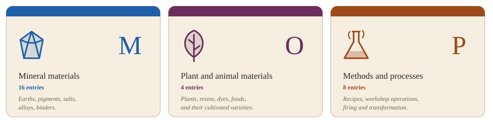
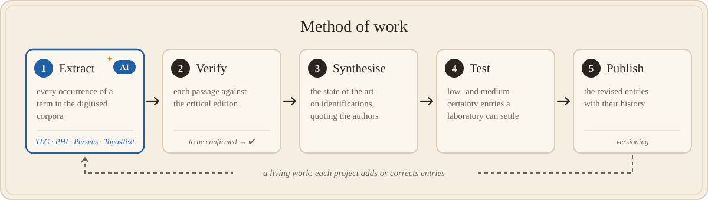

<p align="center">
  
</p>

# The Apolothecary

[](https://doi.org/10.5281/zenodo.24422717)

**A dictionary of lost materials of antiquity. Version 0.4 (22 November 2026).**
Based on the French draft *Dictionnaire des matériaux de l'Antiquité*. Every entry should be revisited against the critical editions and completed with laboratory data.

---

## Using AI to find lost things

Pliny, Theophrastus, Dioscorides and Vitruvius name earths, pigments, plants and recipes that can no longer be identified, located or made with certainty. The words survived; the things they named did not always survive with them.

An *apothecary* was first a storekeeper: the word comes, through Latin *apotheca*, from the Greek ἀποθήκη, "a place where things are put away" ([Wiktionary](https://en.wiktionary.org/wiki/apothecary)). The Apolothecary is a storehouse for what has been lost. Each entry is a jar with a label; the work is to find out what used to be inside.

The evidence is scattered. The Greek and Latin passages sit in several digitised corpora, the translations number their sections differently, and the modern identifications are spread across mineralogy, archaeometry, genetics and microbiology. Few specialists read all of it. This is where AI helps:

- **Search**: extract every occurrence of a term from the digitised corpora (TLG, PHI, Perseus, ToposText), including variant forms.
- **Connect**: line up each passage with the modern identifications and laboratory analyses that concern it.
- **Point**: show where the sources disagree, and which uncertain entries an experiment could settle.

AI is the search engine, not the authority. Every ancient passage it finds is checked against an edition before it earns a ✔, and every modern reference is checked for existence and bibliographic details (see [Status of references](#status-of-references)). A model that invents a citation creates one more lost thing.

The output is a list of questions a laboratory can answer: which Kimolos bentonite was the fuller's earth, whether the *santerna* solder can be rebuilt from Pliny's recipe, what the *misy* of the Cypriot mines was. See [Part V](#part-v).

---

## Contents

- [How to read this dictionary](#how-to-read)
- [The 28 entries at a glance](#at-a-glance)
- [State-of-the-art reviews](#reviews)
- [Part I — Mineral materials (M)](#part-i)
- [Part II — Plant and animal materials (O)](#part-ii)
- [Part III — Methods and processes (P)](#part-iii)
- [Part IV — Candidates for future entries](#part-iv)
- [Part V — Method of work](#part-v)
- [Revision history](#revision-history)
- [About the figures](#about-the-figures)

---

<a id="how-to-read"></a>
## How to read this dictionary

### Purpose

Link each Greek or Latin technical term to (1) its occurrences in ancient texts, (2) the modern identifications that have been proposed, and (3) laboratory analyses, with an explicit degree of certainty. A material is "lost" here when at least one of three things is missing: its **identity** (what it was), its **source** (which deposit or workshop), or its **recipe** (how it was made or processed). This is a living work: each project adds or corrects entries.

<p align="center"></p>

### Scope

The dictionary has three sections, each with its own code:

- **M — Mineral materials**: earths, pigments, salts, alloys, binders.
- **O — Plant and animal materials**: plants, resins, dyes, foods, and the cultivated varieties they come from.
- **P — Methods and processes**: recipes, workshop operations, firing and transformation sequences. A process entry links to the M and O entries for the materials it uses.

For a plant, "lost" can also mean that the species or variety is extinct or unidentified. For a process, it means that steps or parameters (temperature, atmosphere, proportions, duration) are unknown.

<p align="center"></p>

### Entry structure (M and O)

| Field | Content |
|---|---|
| **Term** | Greek and Latin forms, variants |
| **Ancient sources** | Authors and passages |
| **Attested uses** | What the ancients did with it |
| **Provenance** | Places named in the sources |
| **Proposed identifications** | Modern hypotheses, with their authors |
| **Analyses** | Archaeological or reference samples, methods (XRD, spectroscopy, microscopy, microbiology) |
| **What is lost** | Identity, source, recipe, or several of these |
| **Certainty** | High / Medium / Low / Unknown |
| **Open questions** | What remains to be done; possible project |
| **Key references** | Verified modern literature |

### Certainty scale (M and O; see Part III for processes)

-  **High**: identification confirmed by analysed ancient samples *and* by coherent texts.
-  **Medium**: hypothesis supported by mineralogy or provenance, without direct confirmation on ancient material.
-  **Low**: several competing hypotheses, or a term that probably covers different materials.
-  **Unknown**: no serious identification.

<a id="status-of-references"></a>
### Status of references (important)

- **Modern references** were checked one by one for existence, authors, year, journal, volume, pages and DOI (Crossref or DataCite metadata for every DOI; publisher pages or library catalogues for books). Claims attributed to them come from what could be read: the full text when it is open access, otherwise the abstract or the publisher's summary. Each review's *Verification note* says which. Re-read each paper before citing it in a publication.
- **Ancient passages** marked ✔ were checked against an online edition or translation (Perseus, LacusCurtius, ToposText, The Latin Library and others); the review names the text used. Passages marked *(not checked against an edition)* have not been checked yet. Section numbering differs between the Bostock & Riley translation and modern editions of Pliny (Loeb, Budé); entries use the numbering of the modern editions.

### Reference editions and tools for the primary sources

- **Theophrastus**, *On Stones*: E. R. Caley & J. F. C. Richards, *Theophrastus on Stones: Introduction, Greek Text, English Translation, and Commentary*. Columbus: The Ohio State University, 1956 (Graduate School Monographs, Contributions in Physical Science 1). An open-access text is available from Ohio State University Press.
- **Pliny the Elder**, *Natural History*, chemical and mineralogical books: K. C. Bailey, *The Elder Pliny's Chapters on Chemical Subjects*, 2 vols. London: Edward Arnold, 1929–1932. This gives an edited text, translation and notes.
- **Leiden and Stockholm papyri**: R. Halleux (ed., trans.), *Les Alchimistes grecs, tome I: Papyrus de Leyde, Papyrus de Stockholm, Fragments de recettes*. Paris: Les Belles Lettres (Collection des universités de France), 1981. This is the reference edition. It made the Berthelot–Ruelle *Collection des anciens alchimistes grecs* (1887–1888) obsolete.
- **Dioscorides**, *De materia medica*: M. Wellmann (ed.), *Pedanii Dioscuridis Anazarbei De materia medica libri quinque*, 3 vols. Berlin: Weidmann, 1906–1914. Book V (minerals) is in vol. III (1914), scanned at https://archive.org/details/BIUSante_65865x03.
- **Vitruvius**, *De architectura*: F. Krohn (ed.), *Vitruvii De architectura libri decem*. Leipzig: Teubner, 1912 (scan: https://archive.org/details/vitruviidearchit00vitr; Latin text on Perseus).

---

<a id="at-a-glance"></a>
## The 28 entries at a glance

Certainty as given in each entry. Click a code to jump to the entry, or *paper* to read its full state-of-the-art review.

| Code | Entry | What is lost | Certainty | Review |
|---|---|---|---|---|
| [M-01](#m-01) | Cimolian earth | deposit, mineralogy and processing |  | [paper](papers/M-01-Cimolian-earth/paper.md) |
| [M-02](#m-02) | Pozzolana | working recipe: lime state, proportions, placement |  | [paper](papers/M-02-Pozzolana/paper.md) |
| [M-03](#m-03) | Egyptian blue | working recipe and reason for decline |  | [paper](papers/M-03-Egyptian-blue/paper.md) |
| [M-04](#m-04) | Miltos and sinopis | distinguishing the varieties and their quality |  family ·  varieties | [paper](papers/M-04-Miltos-and-sinopis/paper.md) |
| [M-05](#m-05) | Lemnian earth | processing recipe and ancient composition |  processed clay ·  active ingredient | [paper](papers/M-05-Lemnian-earth/paper.md) |
| [M-06](#m-06) | Samian earth | identity, deposit and medicinal mineral |  | [paper](papers/M-06-Samian-earth/paper.md) |
| [M-07](#m-07) | Alum | product range, traded form, Pliny test outcome |  | [paper](papers/M-07-Alum/paper.md) |
| [M-08](#m-08) | Misy | mineral identity, source deposits, refining role |  | [paper](papers/M-08-Misy/paper.md) |
| [M-09](#m-09) | Chrysocolla | goldsmiths' solder identity and santerna recipe |  | [paper](papers/M-09-Chrysocolla/paper.md) |
| [M-10](#m-10) | Natron | map of sources, end of supply |  identity · lower for sources | [paper](papers/M-10-Natron/paper.md) |
| [M-11](#m-11) | Cadmia | natural vs furnace sense, stone's mineralogy, supply |  | [paper](papers/M-11-Cadmia/paper.md) |
| [M-12](#m-12) | Electrum | source of coin metal, refining economics |  meaning ·  source | [paper](papers/M-12-Electrum/paper.md) |
| [M-13](#m-13) | Verdigris | product of each recipe, pigment use |  | [paper](papers/M-13-Verdigris/paper.md) |
| [M-14](#m-14) | Orpiment and sandaraca | meaning of sandaraca per author, mines |  *auripigmentum* ·  *sandaraca* | [paper](papers/M-14-Orpiment-and-sandaraca/paper.md) |
| [M-15](#m-15) | Asbestos | mineral species, spinning technique, analysed cloths |  family ·  species | [paper](papers/M-15-Asbestos/paper.md) |
| [M-16](#m-16) | Chian earth | identity, deposit and processing |  | [paper](papers/M-16-Chian-earth/paper.md) |
| [O-01](#o-01) | Silphium | species, Cyrenaic source, resin harvesting technique |  identity ·  species | [paper](papers/O-01-Silphium/paper.md) |
| [O-02](#o-02) | Judean date | named varieties, plantations, cultivation practices |  species ·  varieties | [paper](papers/O-02-Judean-date/paper.md) |
| [O-03](#o-03) | Judean balsam | cultivated plant, plantations, tapping and refining |  | [paper](papers/O-03-Judean-balsam/paper.md) |
| [O-04](#o-04) | Tyrian purple | vat process and named grade procedures |  chemistry ·  process | [paper](papers/O-04-Tyrian-purple/paper.md) |
| [P-01](#p-01) | Hot mixing of lime mortars | proportions, water dosage, timing, extent of practice |  | [paper](papers/P-01-Hot-mixing-of-lime-mortars/paper.md) |
| [P-02](#p-02) | Attic black gloss | slip recipe, kiln schedule, number of firings |  to  | [paper](papers/P-02-Attic-black-gloss/paper.md) |
| [P-03](#p-03) | Natron glass in tank furnaces | firing schedule, batch recipe, charging sequence |  | [paper](papers/P-03-Natron-glass-in-tank-furnaces/paper.md) |
| [P-04](#p-04) | Egyptian embalming | full recipes, preparation, sequence of applications |  | [paper](papers/P-04-Egyptian-embalming/paper.md) |
| [P-05](#p-05) | Encaustic and Punic wax | punic wax chemistry, painting use, temperatures |  | [paper](papers/P-05-Encaustic-and-Punic-wax/paper.md) |
| [P-06](#p-06) | Garum and fish sauces | salt ratio, duration, temperature, additives |  | [paper](papers/P-06-Garum-and-fish-sauces/paper.md) |
| [P-07](#p-07) | Gold refining by cementation | cement recipe, firing schedule, number of cycles |  to  | [paper](papers/P-07-Gold-refining-by-cementation/paper.md) |
| [P-08](#p-08) | Synthesis of Egyptian blue | workshop recipes, firing schedule, second firing |  to  | [paper](papers/P-08-Synthesis-of-Egyptian-blue/paper.md) |

Lists of terms still to investigate: [O-05](#o-05) (plants and animals), [P-09](#p-09) (processes), [Part IV](#part-iv).

---

<a id="reviews"></a>
## State-of-the-art reviews

Each entry has a full review in its own directory, [`papers/<code>-<name>/paper.md`](papers/). A review sets out the ancient sources with the passage-by-passage verification status, the history of the proposed identifications, the analytical and experimental evidence, what remains lost, open questions, and a verified reference list. Its closing *Verification note* says how each reference was checked and which ones were read in full or only as an abstract.

The same reviews are published as pages of the [project wiki](https://github.com/l0d0v1c/Apolothecary/wiki).

---

<a id="part-i"></a>
##  Part I — Mineral materials (M)
<br clear="left">

<a id="m-01"></a>
### M-01. Cimolia — Cimolian earth (κιμωλία γῆ; *creta Cimolia*)

- **Ancient sources**: Aristophanes, *Frogs* 710–712 ✔ (c. 405 BC; the earliest attestation, among washing agents); Theophrastus, *De lapidibus* 62 ✔ (listed with the Melian, Samian and Tymphaic earths, without description); Strabo 10.5.1 ✔ (the earth comes from Kimolos); Dioscorides 5.156 Wellmann ✔ (white or purplish, "oily" and cold to the touch; the purplish kind is best); Pliny, *NH* 35.195–198 ✔ (medical kinds; use on clothes in the fullers' sequence), 35.36 ✔ (adulterant of *paraetonium*) and many medical recipes (20.212, 21.138, 26.121, 28.110, 28.163, 29.111, 31.118, 34.155 ✔); Ovid, *Met.* 7.463 ✔ (*cretosaque rura Cimoli*). Galen and later medical authors (not checked against an edition).
- **Attested uses**: washing and finishing cloth (scouring after sulphuring, restoring colours); medicine (parotid swellings, burns, inflammations); adulterant of costlier products.
- **Provenance**: Kimolos, Cyclades, close to Melos. Pliny already uses "Cimolian" as a class name, counting Sardinian and Umbrian earths among its kinds (*NH* 35.196), so not every *creta Cimolia* need have come from the island.
- **Proposed identifications**:
  - Caley & Richards (1956): a sepiolite-type clay that mineralogists had called "cimolite", inferred from function and modern use, without analytical data.
  - Robertson (1986): a history of fuller's earth framed around calcium montmorillonite (book not consulted for the review).
  - Kaolin: no scholarly source for this comparison was found, but southern Kimolos has primary kaolins with alunite, so it is geologically plausible.
- **Analyses**: no analysis of an ancient or museum sample has been found, and no ancient extraction site on Kimolos has been identified. The geology is well documented. Christidis (2001) described an alteration profile from rhyolitic glass to montmorillonite bentonite and then to mordenite-bearing bentonite. Christidis (1998) measured cation exchange capacity, swelling, rheology and other properties of several Kimolos bentonites. Christidis & Scott (1997) related the whiteness of Milos and Kimolos bentonites to iron oxide, anatase and structural iron. Tsolis-Katagas & Mavronichi (1989) described the kaolin–alunite zone of southern Kimolos. No modern fulling experiment with Kimolos clays was found.
- **What is lost**: the deposit worked in antiquity, the mineralogy of the traded product (sepiolite, smectite or kaolin), and its processing.
- **Certainty**: **Medium** (island and function secure in the texts; no ancient sample analysed; two incompatible modern identifications).
- **Open questions**: Which deposit was worked, and what was its composition? Do the white and purplish kinds match white and iron-bearing bentonite grades (a hypothesis)? Survey old workings and characterise each lithology by XRD, cation exchange capacity and colour; reproduce Pliny's fulling sequence (*NH* 35.198) with each Kimolos grade; search for clay residues in excavated *fullonicae*. **Possible pilot project**, with the archaeologist.
- **Key references**:
  - Caley, E. R. & Richards, J. F. C. (1956). *Theophrastus On Stones: Introduction, Greek Text, English Translation, and Commentary*. Columbus: The Ohio State University.
  - Robertson, R. H. S. (1986). *Fuller's Earth: A History of Calcium Montmorillonite*. Hythe, Kent: Volturna Press. ISBN 0856060704
  - Christidis, G. E. (1998). Physical and chemical properties of some bentonite deposits of Kimolos Island, Greece. *Applied Clay Science* 13(2): 79–98. doi:10.1016/S0169-1317(98)00023-4
  - Christidis, G. E. (2001). Formation and growth of smectites in bentonites: a case study from Kimolos Island, Aegean, Greece. *Clays and Clay Minerals* 49(3): 204–215. doi:10.1346/CCMN.2001.0490303
  - Christidis, G. E. & Scott, P. W. (1997). The origin and control of colour of white bentonites from the Aegean islands of Milos and Kimolos, Greece. *Mineralium Deposita* 32(3): 271–279. doi:10.1007/s001260050092
  - Tsolis-Katagas, P. & Mavronichi, M. (1989). Kaolinization of the Kimolos Island volcanics, Cyclades, Greece. *Clay Minerals* 24(1): 75–89. doi:10.1180/claymin.1989.024.1.07
- **Full review**: [papers/M-01-Cimolian-earth/paper.md](papers/M-01-Cimolian-earth/paper.md)

---

<a id="m-02"></a>
### M-02. Pulvis puteolanus — pozzolana

- **Ancient sources**: Vitruvius, *De architectura* 2.5.1 ✔ (lime "when slaked"; sand-to-lime ratios), 2.6.1–6 ✔ (the *pulvis* of Baiae and the Vesuvian towns; moles set hard under water) and 5.12.2–3 ✔ (powder brought from Cumae to the promontory of Minerva, mixed "two to one", packed into timber caissons); Strabo 5.4.6 ✔ (the sand of Dikaiarchia/Puteoli and ἀμμοκονία); Seneca, *NQ* 3.20.3 (*Puteolanus pulvis, si aquam attigit, saxum est*; not checked against an edition); Pliny, *NH* 35.166 ✔ (in the sea it becomes a single stone, "stronger every day"), 16.202 and 36.70 ✔ (Claudius' harbour at Ostia). No Greek technical term equivalent to *pulvis Puteolanus* is attested in the texts checked.
- **Attested uses**: hydraulic binder for concrete, including marine structures (harbours, breakwaters, moles).
- **Provenance**: Bay of Naples, around Puteoli (Pozzuoli), Baiae and Cumae; mainly ash from the Campi Flegrei, with Somma-Vesuvius pozzolan used inland at Pompeii. Phlegraean ash travelled as far as the Venice Lagoon (Dilaria et al. 2024).
- **Identification**: reactive (zeolitised) volcanic ash and tuff, mixed with lime. Trace elements tie a Baianus Sinus breakwater to the Phlegraean Fields (Jackson et al. 2013). Other Roman pozzolans existed, such as the Pozzolane Rosse of the Alban Hills in Rome (Jackson et al. 2014).
- **Analyses**:
  - Oleson et al. (2004): the ROMACONS programme cored Roman maritime concrete.
  - Jackson et al. (2013): Al-tobermorite in relict lime clasts of a Baianus Sinus block; lime less than 10 wt% of the mix; modelled peak temperatures of 85–97 °C.
  - Jackson et al. (2017) used synchrotron X-ray microdiffraction on cores from Roman harbour structures. They found Al-tobermorite and phillipsite that crystallised from low-temperature water–rock reactions, in feldspar perimeters, pumice vesicles and relict pores.
  - Seymour et al. (2023), from multiscale elemental and chemical mapping of lime clasts, argue for "hot mixing" with quicklime, with the clasts acting as a reserve of reactive calcium for crack filling (self-healing).
  - Vaserman et al. (2025): an unfinished building site at Pompeii (79 CE) preserves dry quicklime–pozzolan premixes.
- **What is lost**: the working recipe (lime type and state, proportions in practice, underwater placement and curing), and how it varied across sites and centuries. The material itself is not lost.
- **Certainty**: **High**.
- **Open questions**: prepare marine mixes from Vitruvius 2.5.1 and 5.12.2 under both readings of the elliptical "two to one", with slaked lime and with quicklime, and test them in seawater; map where and when quicklime was used; reconstruct the ash trade by glass-shard geochemistry.
- **Key references**:
  - Oleson, J. P., Brandon, C., Cramer, S. M., Cucitore, R., Gotti, E. & Hohlfelder, R. L. (2004). The ROMACONS project: a contribution to the historical and engineering analysis of hydraulic concrete in Roman maritime structures. *International Journal of Nautical Archaeology* 33(2): 199–229. doi:10.1111/j.1095-9270.2004.00020.x
  - Jackson, M. D., Chae, S. R., Mulcahy, S. R., Meral, C., Taylor, R., Li, P., Emwas, A.-H., Moon, J., Yoon, S., Vola, G., Wenk, H.-R. & Monteiro, P. J. M. (2013). Unlocking the secrets of Al-tobermorite in Roman seawater concrete. *American Mineralogist* 98(10): 1669–1687. doi:10.2138/am.2013.4484
  - Jackson, M. D., Mulcahy, S. R., Chen, H., Li, Y., Li, Q., Cappelletti, P. & Wenk, H.-R. (2017). Phillipsite and Al-tobermorite mineral cements produced through low-temperature water-rock reactions in Roman marine concrete. *American Mineralogist* 102(7): 1435–1450. doi:10.2138/am-2017-5993CCBY (open access)
  - Seymour, L. M., Maragh, J., Sabatini, P., Di Tommaso, M., Weaver, J. C. & Masic, A. (2023). Hot mixing: mechanistic insights into the durability of ancient Roman concrete. *Science Advances* 9(1): eadd1602. doi:10.1126/sciadv.add1602
  - Vaserman, E., Weaver, J. C., Hayhow, C., Bergmann, K., Grifa, C., Scalesse, R., Amoretti, V., Russo, A., Iovino, G., Zuchtriegel, G. & Masic, A. (2025). An unfinished Pompeian construction site reveals ancient Roman building technology. *Nature Communications* 16: 10847. doi:10.1038/s41467-025-66634-7
  - Dilaria, S., Ricci, G., Secco, M., Beltrame, C., Costa, E., Giovanardi, T., Bonetto, J. & Artioli, G. (2024). Vitruvian binders in Venice: first evidence of Phlegraean pozzolans in an underwater Roman construction in the Venice Lagoon. *PLOS ONE* 19(11): e0313917. doi:10.1371/journal.pone.0313917
- **Full review**: [papers/M-02-Pozzolana/paper.md](papers/M-02-Pozzolana/paper.md)

---

<a id="m-03"></a>
### M-03. Caeruleum — Egyptian blue (κύανος; *caeruleum*)

- **Ancient sources**: Theophrastus, *De lapidibus* 55 ✔ (kyanos native or prepared, "as in Egypt"; Egyptian, Scythian and Cyprian kinds; a king first made "fused kyanos"), with 51 ✔; Vitruvius 7.11.1 ✔ (invented at Alexandria, later made at Puteoli by Vestorius; sand, *nitri flos* and copper filings rolled into balls and fired in pots); Pliny, *NH* 33.158 and 33.161–163 ✔ (Egyptian, Scythian, Cyprian, Puteolan and Spanish kinds; *lomentum*; *Vestorianum*; "cannot bear lime"; the coal test), 35.49 ✔. In Theophrastus κύανος also covers other blues, probably azurite (Cyprian) and lapis lazuli (Scythian) (Caley & Richards 1956).
- **Attested uses**: pigment (wall painting, polychrome sculpture); Puteolan *caeruleum* also for windows (Pliny). In the Roman period it was traded as pigment balls and was apparently the most common blue on wall paintings.
- **Provenance**: Egypt (Alexandria), then Puteoli. Crucible debris from Cumae and Liternum documents first-century AD production in the northern Phlegraean Fields (Grifa et al. 2016; Lazzarini & Verità 2015).
- **Identification**: calcium copper tetrasilicate CaCuSi₄O₁₀, the synthetic analogue of the mineral cuprorivaite, in a multi-phase material with unreacted quartz and glass. Often called the first synthetic pigment; first use dated to about 2300 BC by Tite & Hatton (2007), about 5000 years ago by others. Pabst (1959) solved the structure (space group *P*4/*ncc*, gillespite type) and judged the identity with cuprorivaite "probable"; it was later confirmed.
- **Analyses**: A pot of the pigment found at Pompeii in 1814 was examined by Humphry Davy (Tite & Hatton 2007). Raman trace phases tie Roman and early medieval pigment to northern Phlegraean (Volturno coast) sands, a sulphidic copper ore and a plant-ash flux (Dariz & Schmid 2021, 2022). Near-infrared luminescence (maximum 910 nm, quantum yield 10.5%, lifetime 107 µs; Accorsi et al. 2009) allows non-contact detection in museums. Bulk CaCuSi₄O₁₀ exfoliates into monolayer nanosheets (Johnson-McDaniel et al. 2013). Laboratory syntheses show that longer firing and slower cooling give a bluer product (McCloy et al. 2025). Use persisted into eighth- to tenth-century Italy, with an isolated case in 1524.
- **What is lost**: the working recipe (raw materials, proportions, calcium source, firing and cooling schedule) and the reason use declined after antiquity.
- **Certainty**: **High**.
- **Open questions**: replicate Vitruvius with Campanian raw materials and Cumae-type crucibles under controlled cooling; reproduce Pliny's coal test and violet-dye fraud; build a Raman trace-phase provenance atlas of dated samples; survey early medieval murals by luminescence imaging to tell a real decline from a sampling gap.
- **Key references**:
  - Pabst, A. (1959). Structures of some tetragonal sheet silicates. *Acta Crystallographica* 12(10): 733–739. doi:10.1107/S0365110X5900216X
  - Accorsi, G., Verri, G., Bolognesi, M., Armaroli, N., Clementi, C., Miliani, C. & Romani, A. (2009). The exceptional near-infrared luminescence properties of cuprorivaite (Egyptian blue). *Chemical Communications* 2009(23): 3392–3394. doi:10.1039/b902563d
  - Grifa, C., Cavassa, L., De Bonis, A., Germinario, C., Guarino, V., Izzo, F., Kakoulli, I., Langella, A., Mercurio, M. & Morra, V. (2016). Beyond Vitruvius: new insight in the technology of Egyptian blue and green frits. *Journal of the American Ceramic Society* 99(10): 3467–3475. doi:10.1111/jace.14370
  - Dariz, P. & Schmid, T. (2021). Trace compounds in Early Medieval Egyptian blue carry information on provenance, manufacture, application, and ageing. *Scientific Reports* 11: 11296. doi:10.1038/s41598-021-90759-6
  - McCloy, J. S., Vicenzi, E. P., Lam, T., Esakoff, J., Olds, T. A., Haney, L. S., Sherif, M., Bussey, J., Dixon Wilkins, M. C. & Karcher, S. (2025). Assessment of process variability and color in synthesized and ancient Egyptian blue pigments. *npj Heritage Science* 13: 202. doi:10.1038/s40494-025-01699-7
  - Johnson-McDaniel, D., Barrett, C. A., Sharafi, A. & Salguero, T. T. (2013). Nanoscience of an ancient pigment. *Journal of the American Chemical Society* 135(5): 1677–1679. doi:10.1021/ja310587c
- **Full review**: [papers/M-03-Egyptian-blue/paper.md](papers/M-03-Egyptian-blue/paper.md)

---

<a id="m-04"></a>
### M-04. Miltos and sinopis — red earths (μίλτος; *rubrica*, *sinopis*)

- **Ancient sources**: Homer, *Il.* 2.637 and *Od.* 9.125 ✔ (μιλτοπάρῃοι, "red-cheeked" ships); Theophrastus, *De lapidibus* 51–54 ✔ (Kean *miltos* the best; Lemnian; "Sinopic", really Cappadocian; three shades; burnt-ochre *miltos*); IG II² 1128 (RO 40), mid-fourth century BC (Kean *miltos* to be exported to Athens only; checked in the AIO English translation, Greek text not checked); Vitruvius 7.7.2 and 7.11.2 ✔; Strabo 3.2.6 and 12.2.10 ✔; Dioscorides 5.96 and 5.126 Wellmann ✔; Pliny, *NH* 33.115–117, 35.30–36, 35.40, 35.50 and 36.147 ✔. Pliny equates Greek *miltos* with Latin *minium* (*NH* 33.115), so μίλτος = *rubrica* is an editorial convention.
- **Attested uses**: pigment (including Pliny's four-colour painters, 35.50), marking, ship maintenance, agriculture (on vines and trees, sometimes with pitch), medicine (astringent wound plasters).
- **Provenance**: Kea; Lemnos; Cappadocia, exported through Sinope and later Ephesus (the "Sinopic" earth); also Egypt, Africa, the Balearics and Iberia.
- **Identification**: red ochres and earthy hematite (iron oxides), natural or made by roasting yellow ochre. Photos-Jones et al. (1997) suggest *miltos* was an umbrella term that included purple as well as red iron oxides. Kassab Tezgör (2022) proposes Cappadocian *yoşa*, still dug for the potters of Avanos, as the descendant of Sinopic *miltos*.
- **Analyses**: Photos-Jones et al. (1997) characterised Kean iron oxides, corroborating the superior quality of some of them. Photos-Jones et al. (2018) analysed four geological samples from Kea and one archaeological sample from Lemnos (chemistry, mineralogy, microbiome, nanofraction): Kean and Lemnian earths differed, and the Lemnian sample would have been more antibacterial. A preliminary XRD of *yoşa* found hematite. No trace-element or isotopic study yet provenances ancient *sinopis*.
- **What is lost**: how to tell the varieties apart (Kean, Lemnian, Sinopic or Cappadocian, and others) and how buyers judged their quality.
- **Certainty**: **High** for the family; **Medium** for the varieties.
- **Open questions**: build a geochemically characterised reference set of red-earth sources and test dated archaeological pigments against it; separate burnt-ochre red from natural red; reproduce Dioscorides' quality criteria as measurements; why did Athens want exclusive control of Kean ruddle (Lytle 2013)?
- **Key references**:
  - Caley, E. R. & Richards, J. F. C. (1956). *Theophrastus On Stones: Introduction, Greek Text, English Translation, and Commentary*. Columbus: The Ohio State University.
  - Photos-Jones, E., Cottier, A., Hall, A. J. & Mendoni, L. G. (1997). Kean miltos: the well-known iron oxides of antiquity. *Annual of the British School at Athens* 92: 359–371. doi:10.1017/S0068245400016737
  - Photos-Jones, E., Knapp, C. W., Venieri, D., Christidis, G. E., Elgy, C., Valsami-Jones, E., Gounaki, I. & Andriopoulou, N. C. (2018). Greco-Roman mineral (litho)therapeutics and their relationship to their microbiome: the case of the red pigment miltos. *Journal of Archaeological Science: Reports* 22: 179–192. doi:10.1016/j.jasrep.2018.07.017
  - Lytle, E. (2013). Farmers into sailors: ship maintenance, Greek agriculture, and the Athenian monopoly on Kean ruddle (IG II² 1128). *Greek, Roman, and Byzantine Studies* 53: 520–550.
  - Kassab Tezgör, D. (2022). From the miltos / sinopis of ancient Sinope to the yoşa of modern Cappadocia. *Adalya* 25: 45–69. doi:10.47589/adalya.1221144
- **Full review**: [papers/M-04-Miltos-and-sinopis/paper.md](papers/M-04-Miltos-and-sinopis/paper.md)

---

<a id="m-05"></a>
### M-05. Lemnian earth — sphragis (Λημνία γῆ, σφραγίς; *terra Lemnia*, *terra sigillata*)

- **Ancient sources**: Theophrastus, *De lapidibus* 52 ✔ (Lemnian *miltos*, as a pigment only); Dioscorides 5.97 Wellmann ✔ (brought up from a cave-like working, mixed with goat's blood, stamped with a goat, called *sphragis*; antidote to poisons; used in rites); Pliny, *NH* 35.33–34 ✔ (a *rubrica* close to minium, sold only sealed, hence *sphragis*; antidote and other uses) and 28.88 ✔ (amulet); Galen, *De simplicium medicamentorum temperamentis ac facultatibus* IX, Kühn XII.169–175, 178–180, 215–216 ✔ (checked in Kühn's Latin translation; Greek not read). Galen describes a priestess collecting the earth with a rite, washing and decanting it, keeping the "fatty" layer and stamping it with the seal of Artemis; the islanders laughed at the goat's blood; he took away twenty thousand *sphragides*. He gives no date for his visit in these passages, and the date AD 167 is unverified.
- **Attested uses**: medicinal (antidote to poisons, venomous bites, old wounds, eye fluxes, haemorrhage), sold as sealed tablets. Galen also distinguishes a craftsmen's *rubrica* and a washing earth on the island. Stamped earths stayed in European pharmacopoeias into the modern period; the practice seems to have waned in late antiquity and been revived under Ottoman rule.
- **Provenance**: Lemnos (Galen visited Hephaestias). Kotsinas, north-east Lemnos, is the presumed extraction locality.
- **Proposed identifications**:
  - Early chemistry (as reported by Venieri et al. 2020): Klaproth (1807) made the first test; De Launay (1895) found "no more than just 'clay'"; Thompson (1914) judged sixteenth-century tablets clay of no pharmacological value.
  - Hall & Photos-Jones (2008) argue that Lemnian earth the *artefact* was not the same as Lemnian earth the *raw material*, and that the ritual may preserve processing steps.
  - A clay with a fungal active component (Photos-Jones et al. 2017; Christidis et al. 2020). Whether it was added deliberately is unresolved: Christidis et al. cite historical evidence for this in their abstract but state in the text that they do not know how the tablets acquired it.
- **Analyses** (on **sixteenth- to eighteenth-century** sphragides in the Museum for the History of Pharmacy, Basel, not ancient ones):
  - Photos-Jones et al. (2017): three Lemnian tablets were significantly antibacterial against *Staphylococcus aureus* (not *Pseudomonas aeruginosa*); Kotsinas clays were not.
  - Christidis et al. (2020): two of the three tablets were active against both pathogens and contained *Talaromyces* spp.; boron and aluminium were ruled out; the fungal load drives the activity. Natural Lemnian clays had neither fungus nor activity.
  - Milling et al. (2024): leachates of *Penicillium purpurogenum* co-cultured with smectite were antibacterial *in vitro* and modulated the gut microbiome of mice (a laboratory model, not a historical tablet).
- **What is lost**: the processing recipe (rite and technique), and the exact composition of the *ancient* product.
- **Certainty**: **Medium** for a processed clay; **Low** for the active ingredient of the ancient product.
- **Open questions**: find and analyse a sphragis of securely ancient date with the Basel protocol; test Galen's washing and decanting sequence on Kotsinas clays; sequence tablet cores and surfaces to tell manufacture from storage contamination.
- **Key references**:
  - Hall, A. J. & Photos-Jones, E. (2008). Accessing past beliefs and practices: the case of Lemnian Earth. *Archaeometry* 50(6): 1034–1049. doi:10.1111/j.1475-4754.2007.00377.x
  - Photos-Jones, E., Edwards, C., Häner, F., Lawton, L., Keane, C., Leanord, A. & Perdikatsis, V. (2017). Archaeological medicinal earths as antibacterial agents: the case of the Basel Lemnian *sphragides*. In: *Geology and Medicine: Historical Connections*. *Geological Society, London, Special Publications* 452: 141–153. doi:10.1144/SP452.6
  - Christidis, G. E., Knapp, C. W., Venieri, D., Gounaki, I., Elgy, C., Valsami-Jones, E. & Photos-Jones, E. (2020). The interweaving roles of mineral and microbiome in shaping the antibacterial activity of archaeological medicinal clays. *Journal of Ethnopharmacology* 260: 112894. doi:10.1016/j.jep.2020.112894
  - Venieri, D., Gounaki, I., Christidis, G. E., Knapp, C. W., Bouras-Vallianatos, P. & Photos-Jones, E. (2020). Bridging the gaps: Bole and Terra Sigillata as artefacts, as simples and as antibacterial clays. *Minerals* 10(4): 348. doi:10.3390/min10040348
  - Milling, S., Ijaz, U. Z., Venieri, D., Christidis, G. E., Rattray, N. J. W., Gounaki, I., Andrusaite, A., Hareendran, A., Knapp, C. W., Jones, A. X. & Photos-Jones, E. (2024). Beneficial modulation of the gut microbiome by leachates of *Penicillium purpurogenum* in the presence of clays: a model for the preparation and efficacy of historical Lemnian Earth. *PLOS ONE* 19(12): e0313090. doi:10.1371/journal.pone.0313090
  - Macgregor, A. (2013). Medicinal *terra sigillata*: a historical, geographical and typological review. *Geological Society, London, Special Publications* 375: 113–136. doi:10.1144/SP375.1
- **Full review**: [papers/M-05-Lemnian-earth/paper.md](papers/M-05-Lemnian-earth/paper.md)

---

<a id="m-06"></a>
### M-06. Samian earth (Σαμία γῆ; *terra Samia*)

*(From the draft's "terms to investigate".)*

- **Ancient sources**: Theophrastus, *De lapidibus* 62–63 ✔ (unsuitable for painters because of its "fat, density and smoothness"; low workings where miners lie on their backs; a layered vein whose last layer is the ἀστήρ; used "mainly, or only, for cloaks"); Dioscorides 5.153 Wellmann ✔ (very white, light, sticking to the tongue "like glue", called κολλούριον; the other kind ἀστήρ, flaky and dense); Pliny, *NH* 35.191 ✔ (two kinds, *collyrium* and *aster*, both white; burnt and washed), 35.193–194 ✔, 28.194, 28.248 and 31.117 ✔ (recipes); Galen, *De simpl. med.* IX, Kühn XII.178–180 (checked in Kühn's Latin translation; Greek not read): the *aster* is preferred, needs no washing and is milder than Lemnian earth. Not to be confused with Samian pottery (*NH* 35.160, 35.165) or the Samian stone for polishing gold (Dioscorides 5.154; *NH* 36.152).
- **Attested uses**: medicine (spitting of blood, uterine flux, inflammations of testicles and breasts, venomous bites and poisons; eye medicines and drying plasters in Pliny); use on cloth (Theophrastus). Dioscorides mentions neither eye salve nor cloth; the name *collyrium* means "eye salve", but the texts do not say whether it records a use.
- **Provenance**: Samos (eastern Aegean). No ancient working has been located; the Glasgow project sampled bentonite and borate deposits near Platanos, western Samos.
- **Proposed identifications**: traditionally equated with kaolin (by whom is not traced). Photos-Jones et al. (2015) instead suggest a composition linked to local **borates** found near bentonitic clays. An undated Glasgow project page suggests that the *collyrium* could be or contain a borate and the *aster* a fuller's earth. The two varieties may be two clays or two layers of one deposit; this is untested.
- **Analyses**: Photos-Jones et al. (2015) tested modern kaolin and bentonite from Samos and Melos, alone and with the borates colemanite and tincalconite, against *Staphylococcus aureus* and *Pseudomonas aeruginosa*: a few hundred ppm of boron made the Samos bentonitic clays significantly antibacterial (abstract only; full results not available). Christidis et al. (2020) showed that reference clays spiked with boron or aluminium become antibacterial, but on Lemnian and Silesian earths and other clays, not Samian earth. No archaeological or museum sample has been analysed.
- **What is lost**: identity of the two varieties (kaolin, or bentonite with borates), the deposit and workings, and the medicinal mineral, if any.
- **Certainty**: **Low**.
- **Open questions**: locate the workings from Theophrastus' description; test candidate clays against the ancient criteria (whiteness, lightness, tongue adhesion, flakiness, fulling); look for boron in any surviving "Samian" earths in pharmacy collections; measure boron in the natural, unspiked Samian clays.
- **Key references**:
  - Photos-Jones, E., Keane, C., Jones, A. X., Stamatakis, M., Robertson, P., Hall, A. J. & Leanord, A. (2015). Testing Dioscorides' medicinal clays for their antibacterial properties: the case of Samian Earth. *Journal of Archaeological Science* 57: 257–267. doi:10.1016/j.jas.2015.01.020
  - Christidis, G. E., Knapp, C. W., Venieri, D., Gounaki, I., Elgy, C., Valsami-Jones, E. & Photos-Jones, E. (2020). The interweaving roles of mineral and microbiome in shaping the antibacterial activity of archaeological medicinal clays. *Journal of Ethnopharmacology* 260: 112894. doi:10.1016/j.jep.2020.112894
  - Venieri, D., Gounaki, I., Christidis, G. E., Knapp, C. W., Bouras-Vallianatos, P. & Photos-Jones, E. (2020). Bridging the gaps: Bole and Terra Sigillata as artefacts, as simples and as antibacterial clays. *Minerals* 10(4): 348. doi:10.3390/min10040348
- **Full review**: [papers/M-06-Samian-earth/paper.md](papers/M-06-Samian-earth/paper.md)

---

<a id="m-07"></a>
### M-07. Alumen and stypteria — alum (στυπτηρία; *alumen*)

*(Listed among the "terms to investigate"; promoted to an entry.)*

- **Ancient sources**: Herodotus 2.180 ✔ (Amasis gives Delphi a thousand talents of alum); Dioscorides 5.106 Wellmann ✔ (sources; the split σχιστή or τριχῖτις, round στρογγύλη and liquid ὑγρά kinds; tests by taste; medical uses); Pliny, *NH* 35.183–190 ✔ ("a brine of the earth"; white and black kinds for dyeing; Egyptian best, Melian next; liquid *phorimon* and inferior *paraphoron*) and 33.65, 33.84, 33.88 ✔ (gilding, gold refining, artificial chrysocolla); Galen, *De simpl. med.* IX, Kühn XII.236–237 (checked in Kühn's Latin translation; Greek not read). Pliny (*NH* 35.184) says that adulteration is detected with pomegranate juice, but what pure alum does falls in a lacuna in Mayhoff's text. A Linear B form *tu-ru-pte-ri-ya* is reported by Photos-Jones (2018) (not checked against an edition).
- **Attested uses**: textiles (dyeing wool), finishing hides, metallurgy (gilding, refining gold, the Leiden and Stockholm papyrus recipes), medicine (astringent: eyes, sores, haemorrhages, loose teeth).
- **Provenance**: Egypt, Melos, Macedonia, Lipara, Strongyle, Sardinia, Hierapolis in Phrygia, Cyprus, Spain, Pontus, Africa, Armenia and other places (Dioscorides, Pliny). Natural alums were worked in Egypt's western oases; a Roman-period workshop at Apothika, Lesbos, made alum from alunite (Archontidou 2005).
- **Identification**: aluminium sulphates and related double sulphates, not necessarily the potassium alum of modern chemistry. Melian *alumen* was a fumarolic, alunogen-rich salt (Al₂(SO₄)₃·17H₂O) with some potassium alum (Hall et al. 2003; Hall & Photos-Jones 2005). Egyptian oasis alums were natural sulphates such as halotrichite and pickeringite (Picon et al. 2005).
- **Analyses**: as reported by Photos-Jones (2018), a Melian sample of alunogen and potassium alum reduced colonies of *Staphylococcus aureus* by about 10⁸ and of *Pseudomonas aeruginosa* by about 10⁷ (Photos-Jones et al. 2016). Melian solfataric alum was purified by dissolution in rain water and evaporation by solar and geothermal heat. Photos-Jones & Christidis (2022) argue from laboratory experiments and XRD that it was shipped as a gel. Apparently pure Melian aluminium sulphate can contain enough iron (more than about 100 ppm) to darken pomegranate juice (Hall & Photos-Jones 2005); the figure of about 40 ppm could not be confirmed. Lipari amphorae (Richborough 527) are linked to alum by context and texts, not residue analysis (Borgard 2005).
- **What is lost**: the range of products sold under one name, the form in which they were traded, and the outcome of Pliny's pomegranate test.
- **Certainty**: **Medium** (a well-defined chemical family, but a commercial term that covers several products; no ancient traded sample analysed).
- **Open questions**: analyse Lipari and Melos amphorae from dye-works and tanneries for aluminium-sulphate residues; replicate Pliny's pomegranate and oak-gall tests at graded iron contents; compare the experimental gels with the ancient "liquid" alum; date the Melian workings.
- **Key references**:
  - Picon, M. (2005). Des aluns naturels aux aluns artificiels et aux aluns de synthèse : matières premières, gisements et procédés. In: Borgard, P., Brun, J.-P. & Picon, M. (eds), *L'alun de Méditerranée*. Naples: Centre Jean Bérard, pp. 13–38. doi:10.4000/books.pcjb.553
  - Hall, A. J. & Photos-Jones, E. (2005). The nature of Melian alumen and its potential for exploitation in antiquity. In: Borgard, P., Brun, J.-P. & Picon, M. (eds), *L'alun de Méditerranée*. Naples: Centre Jean Bérard, pp. 77–84. doi:10.4000/books.pcjb.565
  - Hall, A. J., Fallick, A. E., Perdikatsis, V. & Photos-Jones, E. (2003). A model for the origin of Al-rich efflorescences near fumaroles, Melos, Greece: enhanced weathering in a geothermal setting. *Mineralogical Magazine* 67(2): 363–379. doi:10.1180/0026461036720102
  - Photos-Jones, E., Christidis, G. E., Piochi, M., Keane, C., Mormone, A., Balassone, G., Perdikatsis, V. & Leanord, A. (2016). Testing Greco-Roman medicinal minerals: the case of solfataric alum. *Journal of Archaeological Science: Reports* 10: 82–95. doi:10.1016/j.jasrep.2016.08.042
  - Photos-Jones, E. (2018). From mine to apothecary: an archaeo-biomedical approach to the study of the Greco-Roman lithotherapeutics industry. *World Archaeology* 50(3): 418–433. doi:10.1080/00438243.2018.1515034
  - Photos-Jones, E. & Christidis, G. E. (2022). Solfataric alum exploitation during the Greco-Roman period: some considerations on its nature, enrichment, and preparation for market. In: Hulek, F. & Nomicos, S. (eds), *Ancient Mining Landscapes. Panel 4.2* (Archaeology and Economy in the Ancient World 25). Heidelberg: Propylaeum, pp. 19–33. doi:10.11588/propylaeum.896.c11644
- **Full review**: [papers/M-07-Alum/paper.md](papers/M-07-Alum/paper.md)

---

<a id="m-08"></a>
### M-08. Misy (μίσυ; *misy*)

- **Ancient sources**: Dioscorides 5.100–102 ✔ (Cypriot misy best, "gold-looking … glittering like stars" when crushed); Pliny, *NH* 34.117–122 ✔ and 33.84 ✔; Galen, *De simpl. med.* IX, Kühn XII.226–229 ✔ in Kühn's Latin (Greek not read): at the Soloi mine in Cyprus he saw three bands, sory, chalcitis and misy, and over thirty years saw misy grow on chalcitis in his own stock; a pseudo-Aristotelian fragment on Troodos (not checked against an edition). It belongs to the group with *chalcitis*, *sory* and *melanteria* that later authors called "vitriols".
- **Attested uses**: medicine (caustic, astringent); gold refining, attested by Pliny alone (*NH* 34.121; cementation with salt and misy, 33.84).
- **Proposed identification**: a golden-yellow weathering product of Cypriot copper-sulphide ores. Hoover & Hoover (1912) give two readings: "an oxidized pyrite, mostly iron sulphate", and a yellowish, possibly ochreous material impregnated with vitriol, in part copiapite after Dana. Whether it was one mineral or a trade grade defined by appearance is untested.
- **Analyses**: no analysed ancient sample. Montanari et al. (2024) obtained yellow iron-sulphate phases by heating melanterite, without discussing misy. Celauro, Loepp & Ferro (2017) tested gold-cementation cements containing a weathered mineral called "misy"; the article could not be read.
- **What is lost**: the mineral identity, the source deposits, and its role in gold refining.
- **Certainty**: **Low**.
- **Open questions**: sample yellow efflorescences at Soloi and Skouriotissa and compare them with Dioscorides 5.100 and Pliny *NH* 34.121; repeat Galen's ageing observation; replicate *NH* 33.84.
- **Key references**:
  - Hoover, H. C. & Hoover, L. H. (trans.) (1912). *Georgius Agricola, De re metallica, translated from the first Latin edition of 1556*. London: The Mining Magazine.
  - Montanari, G., Marchini, M., Martelli, M. & Maini, L. (2024). Artificial vitriols: a contemporary interpretation of historical ingredients. *RSC Advances* 14(30): 21538–21543. doi:10.1039/d4ra01896f
  - Celauro, A., Loepp, D. & Ferro, D. (2017). Ancient procedures of gold cementation and gold scorification: considerations on their reliability through experimental archaeology, interpretation of chemical reactions and thermodynamics. *Acta rerum naturalium* 21: 177–200.
- **Full review**: [papers/M-08-Misy/paper.md](papers/M-08-Misy/paper.md)

---

<a id="m-09"></a>
### M-09. Chrysocolla (χρυσόκολλα; *chrysocolla*, *santerna*)

- **Ancient sources**: Theophrastus, *De lapidibus* 26, 39 (κυανὸς αὐτοφυὴς ἔχων ἐν ἑαυτῷ χρυσοκόλλαν), 40, 51 ✔; Vitruvius 7.5.8, 7.9.6, 7.14.2 ✔; Pliny, *NH* 33.86–94 ✔ (natural, artificial and goldsmiths' chrysocolla), 34.116 ✔; Dioscorides 5.89 ✔ (leek-green; no soldering use); Leiden papyrus X, recipe 31 (solder of Cyprian copper 4, *asem* 2, gold 1), checked only in Caley's English translation, not in Halleux (1981).
- **Attested uses**: soldering gold; costly green pigment; medicine.
- **Identification**: ambiguous. The word covers several materials:
  1. an earthy green copper mineral, malachite above all (Caley & Richards 1956);
  2. the goldsmiths' solder (*santerna*): Cyprian verdigris and a boy's urine with *nitrum*, ground with Cyprian copper in Cyprian mortars (*NH* 33.93), probably a copper salt reduced in the joint;
  3. a ready-made copper–silver–gold alloy (Leiden papyrus);
  4. cadmium sulphide (greenockite), proposed by Demortier (1987; 1989) from cadmium in solders on gold from Iran and Syria; disputed by Meeks & Craddock (1991) and unconfirmed. Cadmium solders are now a marker of modern work (Manca et al. 2022).

  Not necessarily the modern mineral chrysocolla (a hydrated copper silicate).
- **What is lost**: the identity of the goldsmiths' material and a tested reconstruction of *santerna*.
- **Certainty**: **Low** overall; the green pigment and drug as a copper mineral are not seriously in doubt.
- **Open questions**: rebuild and test *santerna* and the Leiden alloy; re-examine cadmium on well-provenanced gold with a filtered-detector set-up.
- **Key references**:
  - Caley, E. R. & Richards, J. F. C. (1956). *Theophrastus On Stones: Introduction, Greek Text, English Translation, and Commentary*. Columbus, OH: The Ohio State University.
  - Demortier, G. (1987). La chrysocolle des orfèvres est-elle jaune ? *Archaeometry* 29(2): 275–288. doi:10.1111/j.1475-4754.1987.tb00420.x
  - Demortier, G. (1989). Ancient gold solders: what was chrysocolla? In Allen, R. O. (ed.), *Archaeological Chemistry IV*. Advances in Chemistry 220, pp. 249–263. Washington, DC: American Chemical Society. doi:10.1021/ba-1988-0220.ch013
  - Meeks, N. D. & Craddock, P. T. (1991). The detection of cadmium in gold/silver alloys and its alleged occurrence in ancient gold solders. *Archaeometry* 33(1): 95–107. doi:10.1111/j.1475-4754.1991.tb00688.x
- **Full review**: [papers/M-09-Chrysocolla/paper.md](papers/M-09-Chrysocolla/paper.md)

---

<a id="m-10"></a>
### M-10. Nitrum — natron (νίτρον, Ionic λίτρον; *nitrum*)

- **Ancient sources**: Pliny, *NH* 31.106–122 ✔ (sources in Media, Thrace, Macedonia, Egypt and Lydia; uses) and 36.190–193 ✔ (glass); Herodotus 2.86 ✔ (embalming); Strabo 17.1.23 ✔; Dioscorides 5.113 ✔; Diogenes Laertius 5.42 ✔ (Theophrastus' lost *On salts, nitron and alum*).
- **Attested uses**: glass, dyeing, preserving meat, embalming, medicine.
- **Provenance**: Egypt (Wadi Natrun, al-Barnuj/el-Barnugi), among other places named by Pliny and Dioscorides. Lake Pikrolimni (Macedonia) is a proposed but unconfirmed source.
- **Identification**: a natural evaporite of sodium salts, chiefly carbonates, in a complex mixture.
- **Analyses**: precipitation in the Wadi Natrun is seasonal and probably varies with climate (Shortland 2004). Mineral-natron glass is the glass family of the Greek, Roman and Byzantine worlds (Rehren & Freestone 2015). Raw el-Barnugi natron gave good glass, with more flux than assumed (Jackson et al. 2018). Natron glass ended in Palestine in the eighth century and in Egypt up to a century later, probably through a gradual failure of supply (Phelps et al. 2016). Boron isotopes are being tested as a provenance tracer.
- **What is lost**: little as regards identity; mainly the *map of sources* and the reasons the supply ended.
- **Certainty**: **High** for the identity; lower for the map of sources and the end of supply.
- **Key references**:
  - Shortland, A. J. (2004). Evaporites of the Wadi Natrun: seasonal and annual variation and its implication for ancient exploitation. *Archaeometry* 46(4): 497–516. doi:10.1111/j.1475-4754.2004.00170.x
  - Rehren, Th. & Freestone, I. C. (2015). Ancient glass: from kaleidoscope to crystal ball. *Journal of Archaeological Science* 56: 233–241. doi:10.1016/j.jas.2015.02.021
  - Phelps, M., Freestone, I. C., Gorin-Rosen, Y. & Gratuze, B. (2016). Natron glass production and supply in the late antique and early medieval Near East: the effect of the Byzantine–Islamic transition. *Journal of Archaeological Science* 75: 57–71. doi:10.1016/j.jas.2016.08.006
  - Shortland, A., Schachner, L., Freestone, I. & Tite, M. (2006). Natron as a flux in the early vitreous materials industry: sources, beginnings and reasons for decline. *Journal of Archaeological Science* 33(4): 521–530. doi:10.1016/j.jas.2005.09.011
- **Full review**: [papers/M-10-Natron/paper.md](papers/M-10-Natron/paper.md)

---

<a id="m-11"></a>
### M-11. Cadmia (καδμεία; *cadmea*, *cadmia*)

- **Ancient sources**: Pliny, *NH* 34.100–105 ✔ (two senses: the stone "from which copper alloy is made", useless in medicine, and a furnace deposit in five grades, best from Cyprus), 34.2 and 34.4 ✔ (Marian copper "absorbs *cadmea* best", imitating *aurichalcum* in sestertii); Dioscorides 5.74–75 ✔ (furnace soot; copper workers sprinkling powdered *kadmeia* on copper "wishing to improve it"); Strabo 3.4.15 ✔ (after Posidonius, only Cypriot copper yields the "*kadmeia* stone"); Leiden papyrus X, recipes 11 and 16, in Caley's English only; Galen on the Soloi mine (not checked against an edition).
- **Attested uses**: making copper alloys and brass, medicine (the furnace product).
- **Identification**: a term with two meanings, both zinc-bearing: a furnace deposit, in a special sense zinc oxide (Caley 1926), and a "stone" too vaguely described to name a species (calamine or mixed sulphide ores proposed).
- **Analyses**: Roman brass was made by cementation, which caps zinc at about 28% (Dungworth 1997, citing Craddock 1978). Zwickau crucible slags of the Renaissance separate natural from furnace calamine by lead content (Martinón-Torres & Rehren 2002); no Roman residue has yet been tested this way. The DE-CADMEA project proposes, as a working hypothesis, brass making on Cyprus.
- **What is lost**: the boundary between natural and furnace *cadmia* in each text, the stone's mineralogy, and the Roman supply.
- **Certainty**: **Medium**.
- **Key references**:
  - Craddock, P. T. (1978). The composition of the copper alloys used by the Greek, Etruscan and Roman civilizations. 3. The origins and early use of brass. *Journal of Archaeological Science* 5(1): 1–16. doi:10.1016/0305-4403(78)90015-8
  - Craddock, P. T. (ed.) (1998). *2000 Years of Zinc and Brass*. 2nd, revised edition. British Museum Occasional Paper 50. London: British Museum Press.
  - Dungworth, D. (1997). Iron Age and Roman copper alloys from northern Britain. *Internet Archaeology* 2. doi:10.11141/ia.2.2
  - Martinón-Torres, M. & Rehren, Th. (2002). Agricola and Zwickau: theory and practice of Renaissance brass production in SE Germany. *Historical Metallurgy* 36(2): 95–111.
- **Full review**: [papers/M-11-Cadmia/paper.md](papers/M-11-Cadmia/paper.md)

---

<a id="m-12"></a>
### M-12. Electrum (ἤλεκτρον; *electrum*)

- **Ancient sources**: Pliny, *NH* 33.80 ✔ (gold with a fifth part of silver, natural or made); Herodotus 1.50 ✔ ("white gold", λευκὸς χρυσός), 1.93, 1.94 and 5.101 ✔ (Pactolus gold dust; first coins); Strabo 13.4.5 ✔ (the dust "has failed"). Amber, not the alloy: Herodotus 3.115 ✔, Pliny *NH* 37.31 ✔.
- **Attested uses**: the first coinage (Lydia), goldsmith work.
- **Provenance**: traditionally the Pactolus (Sardis, Lydia). Cahill et al. (2020), as reported by the Sardis expedition, found Sardis stream gold nearly free of silver and proposed the Troad and Mysia instead; untested against the coins.
- **Identification**: a gold–silver alloy, natural or manufactured. The Greek ἤλεκτρον also means amber; the context decides.
- **Analyses**: the sixth-century BC refinery at Pactolus North parted gold by salt cementation and recovered silver by cupellation (Ramage & Craddock 2000, as summarised by Greenewalt 2010). Lydian lion-head coins hold about 54% gold and 44% silver, against about 73% gold for natural Lydian electrum (Kroll 2010). Heavy silver and copper isotopes identify parted gold (Berger et al. 2021).
- **What is lost**: little for the identity; the source of the coin metal and the economics of refining.
- **Certainty**: **High** for the meaning; **Medium** for the source.
- **Key references**:
  - Ramage, A. & Craddock, P. (2000). *King Croesus' Gold: Excavations at Sardis and the History of Gold Refining*. Archaeological Exploration of Sardis, Monograph 11. Cambridge, MA: Archaeological Exploration of Sardis / Harvard University Press; London: British Museum Press.
  - Kroll, J. H. (2010). The coins of Sardis / Sardeis sikkeleri. In Cahill, N. D. (ed.), *Lidyalılar ve dünyaları / The Lydians and Their World*, pp. 143–156. Istanbul: Yapı Kredi Yayınları.
  - Cahill, N. D., Hari, J., Önay, B. & Dokumacı, E. (2020). Depletion-gilding of Lydian electrum coins and the sources of Lydian gold. In van Alfen, P. & Wartenberg, U. (eds), *White Gold: Studies in Early Electrum Coinage*, pp. 291–336. New York and Jerusalem: American Numismatic Society and The Israel Museum.
  - Berger, D., Brauns, M., Brügmann, G., Pernicka, E. & Lockhoff, N. (2021). Revealing ancient gold parting with silver and copper isotopes: implications from cementation experiments and for the analysis of gold artefacts. *Archaeological and Anthropological Sciences* 13(9): 143. doi:10.1007/s12520-021-01369-2
- **Full review**: [papers/M-12-Electrum/paper.md](papers/M-12-Electrum/paper.md)

---

<a id="m-13"></a>
### M-13. Aerugo — verdigris (ἰός; *aerugo*, *aeruca*)

- **Ancient sources**: Theophrastus, *De lapidibus* 57 ✔ (copper over grape residues); Vitruvius 7.12.1 ✔ (*aeruca*, copper strips over vinegar) and 8.3.19 ✔; Dioscorides 5.79 ✔ (vinegar, soured marc, filings; "worm" verdigris, σκώληξ); Pliny, *NH* 34.110–116 ✔ (methods, tests, *scolex*) and 33.93 ✔ (*santerna*); Stockholm papyrus (not checked against an edition).
- **Attested uses**: medicine, an ingredient of the *santerna* solder (see M-09), green pigment (Theophrastus, Vitruvius; Pliny omits it from his pigments, *NH* 35.30).
- **Identification**: neutral and basic copper acetates, a family with several phases still unidentified (Bette, Eggert & Dinnebier 2023). The *scolex* (with alum and salt or natron) and the "natural" Cyprian verdigris may not have been acetates. *Aeris flos* is not a synonym: it is scale from quenched molten copper (Pliny *NH* 34.107; Dioscorides 5.77).
- **Analyses**: one reconstructed recipe gave a mixture of neutral and basic phases (San Andrés et al. 2010). Verdigris in beeswax is identified on a second-century AD Romano-Egyptian portrait (Radpour et al. 2022).
- **What is lost**: which product each ancient recipe made, and most of the record of its pigment use.
- **Certainty**: **Medium**.
- **Open questions**: reproduce each recipe of Dioscorides 5.79 and Pliny *NH* 34.110–116, including the *scolex*, and identify the products by XRD, Raman and FTIR.
- **Key references**:
  - Bette, S., Eggert, G. & Dinnebier, R. E. (2023). Crystalline materials in art and conservation: verdigris pigments – what we know and what we still don't know. *Physical Sciences Reviews* 9(8): 2623–2652. doi:10.1515/psr-2018-0154
  - San Andrés, M., de la Roja, J. M., Baonza, V. G. & Sancho, N. (2010). Verdigris pigment: a mixture of compounds. Input from Raman spectroscopy. *Journal of Raman Spectroscopy* 41(11): 1468–1476. doi:10.1002/jrs.2786
  - Radpour, R., Gates, G. A., Kakoulli, I. & Delaney, J. K. (2022). Identification and mapping of ancient pigments in a Roman Egyptian funerary portrait by application of reflectance and luminescence imaging spectroscopy. *Heritage Science* 10: 8. doi:10.1186/s40494-021-00639-5
  - Scott, D. A. (2002). *Copper and Bronze in Art: Corrosion, Colorants, Conservation*. Los Angeles: Getty Conservation Institute. ISBN 0-89236-638-9.
- **Full review**: [papers/M-13-Verdigris/paper.md](papers/M-13-Verdigris/paper.md)

---

<a id="m-14"></a>
### M-14. Auripigmentum and sandaraca — arsenic sulphides (ἀρρενικόν / ἀρσενικόν, σανδαράκη)

- **Ancient sources**: Theophrastus, *De lapidibus* 40, 50–51 ✔ (from the "dry and smoky exhalation"); Vitruvius 7.7.5, 7.12.2, 8.3.11 ✔; Strabo 12.3.40 ✔ (the deadly Paphlagonian mine); Dioscorides 5.104–105 ✔; Pliny, *NH* 33.79, 34.176–178, 35.30, 35.39–40 ✔, and 11.17 ✔ (*sandaraca* as bee-bread).
- **Attested uses**: yellow and red pigments, medicine.
- **Provenance**: Pontus (Vitruvius), Paphlagonia (Strabo), Mysia and Cappadocia (Dioscorides), Syria (Pliny). A Red Sea island source is reported by Pliny on Juba's authority, and did not reach Rome (*NH* 35.39).
- **Identification**: *auripigmentum* is orpiment (As₂S₃); mined *sandaraca* is realgar (As₄S₄). Vitruvius (7.12.2) and Pliny (*NH* 35.39) also call roasted white lead, i.e. red lead, *sandaraca*; Pliny probably confused the two (Gliozzo & Burgio 2022).
- **Analyses**: realgar alters under light to yellow pararealgar, so "red = realgar, yellow = orpiment" is unreliable. Raman spectroscopy, with XRD and spectrophotometry, separates the phases (Trentelman et al. 1996; Chari et al. 2026).
- **What is lost**: the meaning of *sandaraca* in each author, and the ancient mines.
- **Certainty**: **High** for *auripigmentum*; **Medium** for *sandaraca*.
- **Key references**:
  - Caley, E. R. & Richards, J. F. C. (1956). *Theophrastus on Stones: Introduction, Greek Text, English Translation, and Commentary*. Columbus: The Ohio State University.
  - Gliozzo, E. & Burgio, L. (2022). Pigments—arsenic-based yellows and reds. *Archaeological and Anthropological Sciences* 14(1): 4. doi:10.1007/s12520-021-01431-z
  - Chari, C. S., Vermeulen, M., Eremin, K. & Zheng, S.-L. (2026). Deadly red: photochemical alterations in bonazziite, realgar, pararealgar, and other arsenic sulfide pigments. *Analytical Chemistry* 98(37): 27315–27329. doi:10.1021/acs.analchem.6c01993
- **Full review**: [papers/M-14-Orpiment-and-sandaraca/paper.md](papers/M-14-Orpiment-and-sandaraca/paper.md)

---

<a id="m-15"></a>
### M-15. Asbestos (ἀσβέστινον, ἀμίαντος λίθος; *asbestinon*, *linum vivum*, *amiantus*)

- **Ancient sources**: Strabo 10.1.6 (the Carystian stone that is "combed and woven") ✔; Dioscorides 5.138 (λίθος ἀμίαντος of Cyprus) ✔; Pausanias 1.26.7 (the "Carpasian linen" wick of Callimachus' lamp) ✔; Plutarch, *De defectu oraculorum* 43 (434A), the Carystian source already exhausted ✔; Pliny, *NH* 19.19–20 (book 19 chapter 4 in Bostock and Riley's numbering) ✔ and 36.139 (*amiantus*) ✔; Apollonius Paradoxographus, *Mir.* 36, citing Sotacus (not checked against an edition). Pliny's *asbestos* at *NH* 37.146 is an iron-coloured Arcadian stone with no mention of fibres or fire ✔. Theophrastus, *De lapidibus* 17 (Scapte Hyle) is not asbestos according to Caley and Richards (1956).
- **Attested uses**: towels and napkins cleaned in fire, nets and head-dresses, lamp wicks, royal cremation tunics that kept the body's ash apart from the pyre's (*NH* 19.19). Pliny prices it like the finest pearls (*NH* 19.20).
- **Provenance**: Carystus (southern Euboea) and Cyprus, south-east of Mount Troodos, the only two sources known in or near Greece (Caley and Richards 1956, 87). Pliny's India is unsupported by other classical sources; Laufer's Arcadia rests only on *NH* 37.146 and is doubtful.
- **Identification**: a fibrous silicate mineral of the asbestos group. Whether Pliny thought it a plant is a matter of interpretation: his *nascitur* and *linum* invite the reading, but Laufer (1915) argued that the classical authors regarded it as a mineral and that the vegetable notion arose later.
- **Analyses**: no mineralogical analysis of an ancient Mediterranean asbestos textile was found. Three cloths preserved in Italy (Pozzuoli 1633; a cremation shroud found in 1702 near Porta Maggiore, now in the Vatican Library; Vasto) are known only from early modern descriptions (Laufer 1915, after Yates 1843). Asbestos shrouds come from early first-millennium AD burials at Batujaya, Java (Cameron, Indrajaya and Manguin 2015); tremolite asbestos occurs in Roman building materials at Micia, Romania (Ion et al. 2025). The Cologne burial find formerly cited after Wild (1970, 21) could not be verified and is dropped.
- **What is lost**: the mineral species of each source, the spinning and weaving technique (Pliny's fibres are short and "difficult to weave"), and modern analysis of the surviving cloths.
- **Certainty**: **High** for the family; the mineral species of the sources and of the cloths is unpublished.
- **Open questions**: analyse the Vatican, Naples and ex-Barberini cloths (SEM-EDS, XRD, Raman) with asbestos precautions; sample the Karystos and Cypriot workings; test whether short fibres can be spun without a carrier fibre; read Wild (1970, 21) at source.
- **Key references**:
  - Laufer, B. (1915). Asbestos and salamander: an essay in Chinese and Hellenistic folk-lore. *T'oung Pao* 16(1): 299–373. doi:10.1163/156853215x00149
  - Caley, E. R. & Richards, J. F. C. (1956). *Theophrastus on Stones: Introduction, Greek Text, English Translation, and Commentary*. Columbus: The Ohio State University.
  - Cameron, J., Indrajaya, A. & Manguin, P.-Y. (2015). Asbestos textiles from Batujaya (West Java, Indonesia): further evidence for early long-distance interaction between the Roman Orient, Southern Asia and island Southeast Asia. *Bulletin de l'École française d'Extrême-Orient* 101: 159–176. doi:10.3406/befeo.2015.6212
  - Ion, R.-M. et al. (2025). Tremolite-asbestos presence in Roman archaeological site of Micia, Romania. *Crystals* 15(5): 430. doi:10.3390/cryst15050430
  - Bianchi, C. & Bianchi, T. (2014). Asbestos risk in archaeology. *La Medicina del Lavoro* 105(2): 158.
- **Full review**: [papers/M-15-Asbestos/paper.md](papers/M-15-Asbestos/paper.md)

---

<a id="m-16"></a>
### M-16. Chian earth (Χία γῆ; *terra Chia*)

- **Ancient sources**: Dioscorides 5.155 Wellmann ✔; Pliny, *NH* 35.194 ✔, with the general recipe for medicinal earths at 35.193 ✔; Galen, *De simplicium medicamentorum temperamentis ac facultatibus* 9.1.4 (Kühn XII.180–182) ✔. No full TLG/PHI search was made, so later compilers are not covered. Not to be confused with the Chian stone of Theophrastus (*De lapidibus* 6–7, 33) or Chian mastic.
- **Attested uses**: a mild detergent used instead of natron in the bath; a cosmetic that tightens and brightens the skin of the face and body, used above all by women; an "excellent drug for burns"; inferior to Samian earth for incipient inflammations (Galen).
- **Provenance**: Chios; no extraction site is known.
- **Identification**: none proposed in the literature. The texts describe a white or ash-grey, flaky (πλακώδης), fine earth, moulded into distinctive shapes (Dioscorides 5.155; *candicans*, Pliny). The only studied Chian clay is a Lower–Middle Miocene bentonite south of Thymiana (south-eastern Chios), grey or green, hard and gritty, made of smectite with dolomite and opal-CT (Christidis 1992). Its appearance does not obviously match the ancient description, and no study links it to the ancient earth.
- **Analyses**: none. No ancient or museum sample of Chian earth and no laboratory study of the material is known.
- **What is lost**: identity, deposit and processing.
- **Certainty**: **Unknown**.
- **Open questions**: search the TLG and PHI for later testimony; survey and sample white, flaky clays on Chios, including the Thymiana bentonite; wash and mould samples after Pliny, *NH* 35.193, and compare with Dioscorides; compare with Samian and Selinusian earths using the methods applied to Samian earth (Photos-Jones et al. 2015); look for moulded pieces in Chian collections.
- **Key references**:
  - Christidis, G. E. (1992). *Origin, Physical and Chemical Properties of the Bentonite Deposits from the Aegean Islands of Milos, Kimolos and Chios, Greece*. PhD thesis, University of Leicester.
  - Hall, A. J. & Photos-Jones, E. (2008). Accessing past beliefs and practices: the case of Lemnian earth. *Archaeometry* 50(6): 1034–1049. doi:10.1111/j.1475-4754.2007.00377.x
  - Photos-Jones, E., Keane, C., Jones, A. X., Stamatakis, M., Robertson, P., Hall, A. J. & Leanord, A. (2015). Testing Dioscorides' medicinal clays for their antibacterial properties: the case of Samian Earth. *Journal of Archaeological Science* 57: 257–267. doi:10.1016/j.jas.2015.01.020
- **Full review**: [papers/M-16-Chian-earth/paper.md](papers/M-16-Chian-earth/paper.md)

---

<a id="part-ii"></a>
##  Part II — Plant and animal materials (O)
<br clear="left">

<a id="o-01"></a>
### O-01. Silphium (σίλφιον; *laser*, *laserpicium*)

- **Ancient sources**: Herodotus 4.169 ✔; Theophrastus, *Historia plantarum* 6.3.1–7 ✔ (two conflicting accounts, 6.3.4–6); Aristophanes, *Plutus* 925 ("the silphium of Battus") ✔; Catullus 7.4 ✔; Strabo 17.3.22 ✔ (English translation); Pliny, *NH* 19.38–46 ✔ (the last stalk sent to Nero, 19.39) and 22.100–101 ✔; Apicius book 1 (keeping *laser* with pine kernels; *laseratum*) ✔; Dioscorides 3.80 and Arrian, *Anabasis* 3.28.6–7 (not checked against an edition); coins of Cyrene.
- **Attested uses**: condiment, medicine (including to bring on menstruation and expel a dead foetus, *NH* 22.100–101), fodder, a major export of Cyrene; its juice was sold for its weight in silver denarii (*NH* 19.38).
- **Provenance**: Cyrenaica (eastern Libya), from the island of Platea to the Syrtis (Herodotus 4.169), over more than 4,000 stades (*HP* 6.3.3). Persian, Median, Armenian, Syrian and "Parthian" *laser* replaced it (*NH* 19.40; 22.100).
- **Proposed identifications**:
  - an umbellifer, probably a *Ferula* (Apiaceae), on the strength of its *ferula*-like stalk (*HP* 6.3.1); asafoetida (*F. assa-foetida*) was the later substitute, not the Cyrenaic plant;
  - *Ferula drudeana*, a rare central Anatolian endemic, proposed by Miski (2021): pleasant-smelling gum-resin, about thirty secondary metabolites, three populations near formerly Greek villages. **Contested**: nrDNA ITS places it in a mainly Central Asian clade, apart from the North African *Ferula* (Piwczyński et al. 2018).
  - *Ferula tingitana* has been listed, but no checkable peer-reviewed source for it was found.
- **Why it disappeared**: Pliny blames tax-farmers letting flocks graze it out (*NH* 19.39); Strabo reports deliberate destruction of roots by nomads (17.3.22). Parejko (2003) called it the first recorded species extinction. Pollaro & Robertson (2022) argue instead for anthropogenic habitat change and desertification, from the cold-stratification needs of silphium's presumed closest living relatives; that premise is weakened by the phylogenetic results.
- **Analyses**: no specimen, seed or identified residue of Cyrenaic silphium exists. All laboratory work concerns modern *F. drudeana*: root coumarins (Kuran et al. 2025), fruit oil dominated by shyobunone (Tosun et al. 2023), resin aroma and Apicius recipes distinct from asafoetida (Agnini et al. 2026).
- **What is lost**: identity (no specimen survives), the source, and the cutting and curing of the resin (with meal or bran).
- **Certainty**: **Low** (identity); **Unknown** for a confirmed species.
- **Open questions**: archaeobotany in Cyrenaica and in shipwreck cargoes off Libya (Briggs & Jakobsson 2022), with ancient DNA placed against the *Ferula* clades; chemical markers separating Cyrenaic-type resin from asafoetida; germination tests on North African *Ferula*; experimental curing with meal or bran.
- **Key references**:
  - Amigues, S. (2004). Le silphium — état de la question. *Journal des Savants* 2004(2): 191–226. doi:10.3406/jds.2004.1685
  - Miski, M. (2021). Next chapter in the legend of silphion: preliminary morphological, chemical, biological and pharmacological evaluations, initial conservation studies, and reassessment of the regional extinction event. *Plants* 10(1): 102. doi:10.3390/plants10010102
  - Pollaro, P. & Robertson, P. (2022). Reassessing the role of anthropogenic climate change in the extinction of silphium. *Frontiers in Conservation Science* 2: 785962. doi:10.3389/fcosc.2021.785962
  - Piwczyński, M., Wyborska, D., Gołębiewska, J. & Puchałka, R. (2018). Phylogenetic positions of seven poorly known species of *Ferula* (Apiaceae) with remarks on the phylogenetic utility of the plastid *trnH-psbA*, *trnS-trnG*, and *atpB-rbcL* intergenic spacers. *Systematics and Biodiversity* 16(5): 428–440. doi:10.1080/14772000.2018.1442374
  - Briggs, L. & Jakobsson, J. (2022). Searching for silphium: an updated review. *Heritage* 5(2): 936–955. doi:10.3390/heritage5020051
  - Parejko, K. (2003). Pliny the Elder's silphium: first recorded species extinction. *Conservation Biology* 17(3): 925–927. doi:10.1046/j.1523-1739.2003.02067.x
- **Full review**: [papers/O-01-Silphium/paper.md](papers/O-01-Silphium/paper.md)

---

<a id="o-02"></a>
### O-02. The Judean date (φοῖνιξ; *palma*, the dates called *caryotae* and *nicolai*)

- **Ancient sources**: Pliny, *NH* 5.70 and 5.73 (palm groves of Jericho and Ein Gedi) ✔, 13.26–27 ✔, 13.44–46 (*caryotae*, *nicolai*, *adelphides*, *patetae*, *chydaei*) ✔, 13.49 (keeping quality) ✔; Strabo 16.2.41 (the Phoenicon of Jericho) ✔ (English translation); Josephus, *Bellum Judaicum* 4.468–469 and *Antiquitates* 14.54, 15.96 ✔ (English translation); Tacitus, *Historiae* 5.6 ✔ (English translation). The Galen passage once listed here has no reference and was not located.
- **Attested uses**: a fruit for eating; pressed into a "honey" little inferior to bees' honey (Josephus) and made into the principal wines of the East (*NH* 13.44); the dates of Judea and Cyrenaica alone kept well (*NH* 13.49).
- **Provenance**: Judea, Dead Sea region: Jericho above all, also Archelais, Phasaelis, Livias (*NH* 13.44) and Ein Gedi.
- **Identification**: *Phoenix dactylifera*. The species is not lost; **the cultivated varieties are**. Date culture continued to the 11th century AD; elite cultivars no longer propagated by offshoots were replaced by seedlings, and no trace of the plantations remained by the 19th century (Sallon et al. 2020).
- **Analyses**:
  - Sallon et al. (2008) germinated the Masada seed "Methuselah". Sallon et al. (2020) added six more from Masada, Qumran and Wadi Makukh (seven genotypes, two of them female). The ancient seeds are on average 27.69% wider and 38.37% longer than modern ones. Microsatellites show mixed eastern and western gene pools, the oldest palms mainly eastern, the youngest most western.
  - Gros-Balthazard et al. (2021) sequenced the seven genomes, dated between the 4th century BC and the 2nd century AD. Segments of the Cretan palm *Phoenix theophrasti* were already present in the eastern Mediterranean gene pool by about 2,400 to 2,000 years ago, rising from minimal in the oldest samples to about 10.3% in the youngest.
  - Methuselah's date differs between the 2008 report (1st century AD) and the 2020 study (1st to 4th century BC).
- **What is lost**: the named varieties, the plantations and the cultivation and processing practices. Each revived palm is a seedling, not a clone of a named cultivar; no genotype has been matched to a variety.
- **Certainty**: **High** for the species and the ancient genotypes; **Low** for linking any revived palm to a named variety.
- **Open questions**: describe the fruit of the female ancient palms (Hannah, Judith) under controlled pollination and compare it with Pliny's criteria (*NH* 13.44–45); screen modern Levantine, North African and Iraqi cultivars for clonal identity with the ancient genotypes; locate the Galen and rabbinic references.
- **Key references**:
  - Sallon, S., Solowey, E., Cohen, Y., Korchinsky, R., Egli, M., Woodhatch, I., Simchoni, O. & Kislev, M. (2008). Germination, genetics, and growth of an ancient date seed. *Science* 320(5882): 1464. doi:10.1126/science.1153600
  - Sallon, S., Cherif, E., Chabrillange, N., Solowey, E., Gros-Balthazard, M., Ivorra, S., Terral, J.-F., Egli, M. & Aberlenc, F. (2020). Origins and insights into the historic Judean date palm based on genetic analysis of germinated ancient seeds and morphometric studies. *Science Advances* 6(6): eaax0384. doi:10.1126/sciadv.aax0384
  - Gros-Balthazard, M., Flowers, J. M., Hazzouri, K. M., Ferrand, S., Aberlenc, F., Sallon, S. & Purugganan, M. D. (2021). The genomes of ancient date palms germinated from 2,000 y old seeds. *Proceedings of the National Academy of Sciences of the USA* 118(19): e2025337118. doi:10.1073/pnas.2025337118
- **Full review**: [papers/O-02-Judean-date/paper.md](papers/O-02-Judean-date/paper.md)

---

<a id="o-03"></a>
### O-03. Judean balsam — opobalsamum (βάλσαμον, ὀποβάλσαμον; *balsamum*, *opobalsamum*)

- **Ancient sources**: Theophrastus, *Historia plantarum* 9.1.6–7 and 9.6.1–4 ✔; Strabo 16.2.41 ✔ (English translation); Pliny, *NH* 12.111–123 ✔; Josephus, *Antiquitates* 14.54, 15.96 ✔ and 8.174 (sentence read, section number unconfirmed), *Bellum Judaicum* 4.469 ✔ (English translation); Tacitus, *Historiae* 5.6 ✔ (English translation); Dioscorides 1.19 (not checked against an edition). The Hebrew Bible's *tsori* (צֳרִי, "balm"; Gen. 37:25, Jer. 8:22, Ezek. 27:17 ✔) is traditionally equated with it, but this is debated.
- **Attested uses**: perfume, medicine (headache, incipient cataract, dim sight: Strabo); graded into sap, seed, bark and wood (*xylobalsamum*) products and heavily adulterated (*NH* 12.118–123). Sold for twice its weight in silver (Theophrastus *HP* 9.6.4; *NH* 12.117), not gold. It was the most valuable export of ancient Judea.
- **Provenance**: royal gardens near Jericho and at Ein Gedi; extended under Roman fiscal control (*NH* 12.111–113). Said not to grow wild anywhere (*HP* 9.6.4). Gone from the region by the 9th century AD; a garden at Matariyya (Matarea) in Egypt survived until 1615 (Milwright 2021).
- **Proposed identification**: *Commiphora gileadensis*, the leading candidate since the 18th century, contestable because of morphological differences and the lack of verified *Commiphora* remains in the southern Levant (Sallon et al. 2024). Pliny's cuttings, vine-like training and three named kinds (*NH* 12.112–114) point to a cultivated clone or cultivars.
- **Analyses**: no ancient balsam or residue has been analysed. Sallon et al. (2024) germinated a seed from a cave in lower Wadi el-Makkuk (Judean desert), radiocarbon-dated to AD 993–1202. It is an unknown *Commiphora* of the "Spinescens" clade, sister to three southern African species and not closely related to *C. gileadensis*. It has minimal fragrant compounds and is rich in squalene, triterpenoids and new glycolipids. The authors link it to the biblical *tsori*, not to the Roman balsam. Being medieval and unscented, it neither confirms nor excludes *C. gileadensis*.
- **What is lost**: the cultivated plant (species or cultivar), the plantations, and the tapping, grading and refining methods. The sources disagree on the cutting tool: iron (Theophrastus) against glass, stone or bone (Pliny, Tacitus, Josephus).
- **Certainty**: **Low**.
- **Open questions**: GC-MS of residues in juglets and unguentaria from Jericho, Ein Gedi and Qumran contexts, compared with *C. gileadensis* resin and the "Sheba" profile; archaeobotanical search of plantation sites; phylogenetic placement of Arabian and East African *C. gileadensis*; sequencing of any material traceable to the Matarea garden.
- **Key references**:
  - Sallon, S., Solowey, E., Gostel, M. R., Egli, M., Flematti, G. R., Bohman, B., Schaeffer, P., Adam, P. & Weeks, A. (2024). Characterization and analysis of a *Commiphora* species germinated from an ancient seed suggests a possible connection to a species mentioned in the Bible. *Communications Biology* 7: 1109. doi:10.1038/s42003-024-06721-5
  - Ben-Yehoshua, S., Borowitz, C. & Hanuš, L. O. (2012). Frankincense, myrrh, and balm of Gilead: ancient spices of southern Arabia and Judea. *Horticultural Reviews* 39: 1–76. doi:10.1002/9781118100592.ch1
  - Milwright, M. (2021). *The Queen of Sheba's Gift: A History of the True Balsam of Matarea*. Edinburgh: Edinburgh University Press. doi:10.1515/9780748668502
  - Hepper, F. N. & Taylor, J. E. (2004). Date palms and opobalsam in the Madaba mosaic map. *Palestine Exploration Quarterly* 136(1): 35–44. doi:10.1179/003103204225014193
- **Full review**: [papers/O-03-Judean-balsam/paper.md](papers/O-03-Judean-balsam/paper.md)

---

<a id="o-04"></a>
### O-04. Purpura — Tyrian purple (πορφύρα; *purpura*, *ostrum*)

*(Moved from the mineral section; the dye chemistry is unchanged. See also P-09 for the vat process.)*

- **Ancient sources**: Pliny, *NH* 9.125–141 ✔: the gland (9.125–126), *bucinum* and *purpura/pelagia* (9.130), the vat with salt, three days' steeping, heating in lead and a test about the tenth day (9.133), the amethyst and Tyrian baths (9.134–135, with a lacuna in the proportions), *dibapha* and its prices (9.137), *conchyliata* with urine (9.138); Pliny, *NH* 35.44–45 (*purpurissum*) ✔; Vitruvius 7.13.1–3 (*ostrum* as pigment) and 7.14.1–2 (imitation purples) ✔. Leiden Papyrus X and Stockholm Papyrus (purple recipes and imitations; not checked against an edition).
- **Attested uses**: dyeing wool; marking rank (fasces, *praetexta*, senatorial stripe, triumphal robe, *NH* 9.127); a painters' pigment (*purpurissum*, *ostrum*).
- **Identification**: mainly 6,6′-dibromoindigo, with 6-bromoindigo and 6,6′-dibromoindirubin, from the hypobranchial gland of muricid snails (*Bolinus brandaris*, *Hexaplex trunculus*, *Stramonita haemastoma*). Friedländer identified it in 1909 from 12,000 *Murex brandaris*. *H. trunculus* gives an indigo-rich pigment (about 55% indigo, 3% dibromoindigo), the other species 77–91% dibromoindigo (Cooksey 2001). Pliny's two shells have no securely published modern equivalents.
- **Analyses**: production at Kolonna, Aegina, 16th century BC, almost exclusively from *H. trunculus* (Berger et al. 2024); dibromoindigotin-dyed textiles from Timna, late 11th to early 10th century BC (Sukenik et al. 2021); Iron Age workshops at Tel Shiqmona (Shalvi et al. 2025). Experimental vats work by bacterial reduction in a warm, mildly alkaline, covered bath over about ten days (Cooksey 2001; Koren 2013); Koren reads Pliny's "salt" as an alkaline salt.
- **What is lost**: the vat process (the nature of Pliny's "salt", the reducing system, temperatures, durations, proportions) and the procedures behind the named grades (*dibapha*, Tyrian, amethyst, *conchyliata*).
- **Certainty**: **High** for the chemistry; **Low** for the industrial process.
- **Open questions**: reproduce Pliny's sequence under controlled pH, temperature and oxygen and compare dyed wool by HPLC with archaeological profiles; test urine and dilution in the *conchyliata* recipe; analyse vat residues for alkaline salts, lead or tin; look for chemical signatures of *dibapha* and *hysginum*; read the papyri and Caley's translations.
- **Key references**:
  - Cooksey, C. J. (2001). Tyrian purple: 6,6′-dibromoindigo and related compounds. *Molecules* 6(9): 736–769. doi:10.3390/60900736
  - Friedländer, P. (1909). Über den Farbstoff des antiken Purpurs aus *murex brandaris*. *Berichte der deutschen chemischen Gesellschaft* 42(1): 765–770. doi:10.1002/cber.190904201122
  - Koren, Z. C. (2013). New chemical insights into the ancient molluskan purple dyeing process. *ACS Symposium Series* 1147: 43–67. doi:10.1021/bk-2013-1147.ch003
  - Karapanagiotis, I. (2019). A review on the archaeological chemistry of shellfish purple. *Sustainability* 11(13): 3595. doi:10.3390/su11133595
  - Berger, L., Forstenpointner, G., Frühauf, P. & Kanz, F. (2024). More than just a color: archaeological, analytical, and procedural aspects of Late Bronze Age purple-dye production at Cape Kolonna, Aegina. *PLOS ONE* 19(6): e0304340. doi:10.1371/journal.pone.0304340
- **Full review**: [papers/O-04-Tyrian-purple/paper.md](papers/O-04-Tyrian-purple/paper.md)

---

<a id="o-05"></a>
### O-05. Plant and animal terms to investigate

Kyphi (Egyptian temple incense; recipes in Plutarch and Dioscorides), *malabathrum*, *nardus*, *cinnamomum* and *casia* (whose ancient identity is debated), *styrax*, *mandragora*, *helleborus*, *kermes* / *coccum* (insect red dye), *rubia* (madder), *isatis* (woad), *papyrus* (as a material).

---

<a id="part-iii"></a>
##  Part III — Methods and processes (P)
<br clear="left">

### Entry structure for a process

| Field | Content |
|---|---|
| **Name** | Ancient name if one exists; descriptive modern name |
| **Ancient sources** | Texts, recipes, inscriptions, labels |
| **Steps attested** | What the texts or the archaeology show |
| **Materials involved** | Links to M- and O- entries |
| **Archaeological evidence** | Workshops, furnaces, vessels, waste |
| **Analyses and reconstructions** | Laboratory characterisation; experimental archaeology |
| **What is lost** | Which steps or parameters are unknown |
| **Certainty** | See scale below |

### Certainty scale for processes

-  **High**: a reconstruction reproduces the ancient product, and its analyses match the archaeological material.
-  **Medium**: the main steps are known (texts or archaeology), but key parameters (temperature, atmosphere, proportions, duration) are still inferred.
-  **Low**: only the product is known; the process is reconstructed by hypothesis.
-  **Unknown**: the product or the process is attested only in texts.

---

<a id="p-01"></a>
### P-01. Hot mixing of Roman lime mortars

- **Materials**: quicklime burnt from limestone, marble or travertine; pozzolana (M-02), or crushed ceramic (*cocciopesto*) and sand; water; *caementa* (tuff, brick).
- **Ancient sources**: no ancient author describes hot mixing. The texts describe slaked lime and give volumetric ratios: Cato, *De agricultura* 38 (lime kiln) and 18 ✔; the Puteoli building contract of 105 BCE, CIL X 1781 (*calcis restinctai partem quartam*; checked against an online transcription, not the printed CIL); Vitruvius, *De architectura* 2.5.1–3 (*cum ea erit extincta*, then 3:1 pit sand or 2:1 river or sea sand to lime) ✔, 2.6.1 ✔, 5.12.2–3 (harbour mortar, "two to one") ✔, 7.2.1–2 (lime for stucco slaked long in advance; unslaked lumps raise blisters) ✔; Pliny, *NH* 35.166 ✔ and 36.174–177 ✔.
- **Steps attested / inferred**: (1) lime burnt in a kiln (texts); (2) quicklime granules several millimetres in size dry-mixed with pozzolan and stored in piles, attested at one site, Domus IX 10, 1 at Pompeii in 79 CE (Vaserman et al. 2025); (3) wetting and mixing, with an exothermic temperature rise known only from modern hot-lime mortars (inferred); (4) slaked lime sometimes added, especially for repairs (inferred from Ca/Si ratios); (5) laying with *caementa*; (6) lime clasts with a Si–Al-rich rim and a calcium-rich core persist and are proposed to act as a calcium reservoir that fills later cracks (Seymour et al. 2023).
- **Analyses and reconstructions**: Seymour et al. (2023) interpreted lime clasts in the city-wall mortar of Privernum by SEM-EDS, XRD and Raman imaging as the product of quicklime hydrating under hot, water-poor conditions; their modern hot-mixed mixes sealed 0.5 mm cracks within 30 days, while clast-free controls did not. At Pompeii, FTIR grinding curves and δ13C/δ18O values of the clasts matched quicklime rather than slaked-lime references, in both the original construction and the post-62 CE repairs (Vaserman et al. 2025). No reproduction following the Pompeian sequence has been published.
- **What is lost**: proportions of quicklime to pozzolan, water quantity (the decisive variable in hot-lime mortars), storage time of the dry mix, quicklime grain size, the interval between wetting and laying, and how widespread the practice was.
- **Certainty**: **Medium**. Quicklime dry-mixed with pozzolan is materially attested at one site, but the parameters and extent are inferred, and the texts describe slaked lime.
- **Open questions**: apply the FTIR and isotopic criteria blind to Roman mortars of other dates, regions and functions, with reference mortars of known preparation; reproduce the Pompeian dry pre-mix experimentally; test whether any Latin slaking term (*extinguere*, *restinguere*, *macerare*) can designate hydration within the mix; long-term self-healing in ancient structures remains a hypothesis.
- **Key references**:
  - Seymour, L. M., Maragh, J., Sabatini, P., Di Tommaso, M., Weaver, J. C. & Masic, A. (2023). Hot mixing: mechanistic insights into the durability of ancient Roman concrete. *Science Advances* 9(1): eadd1602. doi:10.1126/sciadv.add1602
  - Vaserman, E., Weaver, J. C., Hayhow, C., Bergmann, K., Grifa, C., Scalesse, R., Amoretti, V., Russo, A., Iovino, G., Zuchtriegel, G. & Masic, A. (2025). An unfinished Pompeian construction site reveals ancient Roman building technology. *Nature Communications* 16: 10847. doi:10.1038/s41467-025-66634-7
  - Pavia, S., Veiga, R., Hughes, J., Pesce, G., Valek, J., Alvarez, J. I., Faria, P. & Padovnik, A. (2023). RILEM TC 277-LHS report: How hot are hot-lime-mixed mortars? A review. *Materials and Structures* 56(4): 87. doi:10.1617/s11527-023-02157-1
- **Full review**: [papers/P-01-Hot-mixing-of-lime-mortars/paper.md](papers/P-01-Hot-mixing-of-lime-mortars/paper.md)

---

<a id="p-02"></a>
### P-02. Attic black gloss — three-stage firing

- **Materials**: a fine, iron-rich, non-calcareous, illite-rich clay suspension; the iron-oxide red earths (M-04) are not identified as an ingredient by the analytical studies.
- **Ancient sources**: **no text describes the slip or the firing schedule**; the process is reconstructed entirely from the material. Indirect witnesses: the pseudo-Homeric *Kiln* epigram (Homeric Epigram 14, lines 1–23), which asks Athena to make the vessels "well fired" and names the kiln-demons, with the variant μελανθοῖεν ("may they turn black") at line 3 ✔; the Ephesian decree granting citizenship to the Athenian potters Kittios and Bakchios for "black pottery" (I.Ephesos 1420; not checked against an edition); the Corinthian *pinakes* from Penteskouphia showing kilns (iconographic).
- **Steps (consensus model)**: the clay is refined by levigation (or suspension, peptisation and precipitation) and thickened; deflocculating additives are a hypothesis. The paint is applied to the leather-hard pot and fired in one cycle: oxidising up to about 850–900 °C (all red, Fe³⁺); reducing, when iron becomes black magnetite and hercynite and the painted layer vitrifies and seals them; re-oxidising, when the porous body returns to red hematite (via maghemite) while the gloss stays black.
- **Analyses and reconstructions**: the black layer is about 20 µm of sub-0.2 µm magnetite in a vitreous matrix (Maniatis et al. 1993). Reproductions fired oxidising–reducing–oxidising have been matched to ancient sherds by confocal XANES (Lühl et al. 2014) and by systematic replicate series (Cianchetta et al. 2016). Walton et al. (2013) showed that a relief line on one red-figure sherd required a separate, hotter firing. Cianchetta et al. (2015, *JAAS*) found, on the neck of a red-figure hydria attributed to the Berlin Painter (Getty 81.AE.206.d.2005), a red gloss layer fired at about 950 °C under black gloss fired in a second three-stage cycle; in their replicates, black on red was obtained only with the first stage below 900 °C and re-oxidation below 700 °C. Zn enrichment in slips (Walton et al. 2015) is read either as a processing trace (vitriol) or as a natural feature of clays from mining areas; Solard et al. (2023) leave it undecided.
- **What is lost**: how the slip was refined and whether additives were used; the actual kiln schedule (temperatures, durations, how reduction was produced in a wood-fired kiln); how many firings a given vessel received; how bichrome black-and-red vessels were made.
- **Certainty**: **Medium to High**. High for the principle, which reproductions match analytically; Medium for the slip recipes and firing schedules of individual workshops.
- **Open questions**: replicate with Attic illitic clays in a wood-fired updraft kiln, logging temperature and oxygen; test pre-modern deflocculants and the vitriol hypothesis; map Zn in Attic clays against slips; survey how common multiple firings were; check I.Ephesos 1420 against its edition.
- **Key references**:
  - Walton, M., Trentelman, K., Cummings, M., Poretti, G., Maish, J., Saunders, D., Foran, B., Brodie, M. & Mehta, A. (2013). Material evidence for multiple firings of ancient Athenian red-figure pottery. *Journal of the American Ceramic Society* 96(7): 2031–2035. doi:10.1111/jace.12395
  - Cianchetta, I., Trentelman, K., Maish, J., Saunders, D., Foran, B., Walton, M., Sciau, Ph., Wang, T., Pouyet, E., Cotte, M., Meirer, F., Liu, Y., Pianetta, P. & Mehta, A. (2015). Evidence for an unorthodox firing sequence employed by the Berlin Painter: deciphering ancient ceramic firing conditions through high-resolution material characterization and replication. *Journal of Analytical Atomic Spectrometry* 30(3): 666–676. doi:10.1039/c4ja00376d
  - Lühl, L., Hesse, B., Mantouvalou, I., Wilke, M., Mahlkow, S., Aloupi-Siotis, E. & Kanngiesser, B. (2014). Confocal XANES and the Attic black glaze: the three-stage firing process through modern reproduction. *Analytical Chemistry* 86(14): 6924–6930. doi:10.1021/ac500990k
  - Walton, M., Trentelman, K., Cianchetta, I., Maish, J., Saunders, D., Foran, B. & Mehta, A. (2015). Zn in Athenian black gloss ceramic slips: a trace element marker for fabrication technology. *Journal of the American Ceramic Society* 98(2): 430–436. doi:10.1111/jace.13337
  - Solard, B., Amicone, S., Aloupi-Siotis, E., Heinze, L., Berti, F., Lambrugo, C. & Berthold, C. (2023). Back to black: a mineralogical and chemical characterisation of Atticising fourth century BCE black gloss ware. *Archaeological and Anthropological Sciences* 15(9): 135. doi:10.1007/s12520-023-01822-4
- **Full review**: [papers/P-02-Attic-black-gloss/paper.md](papers/P-02-Attic-black-gloss/paper.md)

---

<a id="p-03"></a>
### P-03. Primary production of natron glass in tank furnaces

- **Materials**: natron (M-10), probably Egyptian or North African; coastal sand supplying both silica and lime (in the Levant, lime from shell fragments); manganese as a primary-stage decolouriser at Jalame.
- **Ancient sources**: Pliny, *NH* 5.75 (the Belus near Ptolemais, "sands fertile in glass") ✔ and 36.190–194 (Belus sand; the natron merchants' origin story; melting "in continuous furnaces" into blackish lumps, *massae*, then remelting *in officinis*; the "new" Volturnus method with *hammonitrum*) ✔. In 36.193 *maxime Aegyptio* is a conjecture in Mayhoff's apparatus, and the "three parts of *nitrum*" in 36.194 is grammatically ambiguous. Strabo 16.2.25 (Belus sand taken to Sidon for melting) ✔; Josephus, *BJ* 2.189–191 ✔; Tacitus, *Hist.* 5.7 ✔. The Edict of Diocletian's "Alexandrian" glass (not checked against an edition).
- **Steps attested**: two stages. Primary workshops melted sand and natron in tank furnaces, in charges of many tonnes; the cooled slab was broken into chunks, traded and remelted in secondary workshops. Beni Salama (Wadi Natrun, 1st–2nd centuries CE): four tanks with basins of 7.5 × 2 m and 6.10 × 2 m, slabs of 15–20 tonnes, a wall and part of the vault dismantled to reach the slab. Apollonia-Arsuf (6th–7th centuries) had a firing area and a melting chamber; Bet Eli'ezer (8th century) had 17 tank furnaces with a minimum capacity of 8–10 tonnes each; Jalame (4th century) had a lime-rich lining. Incremental charging of the batch is proposed, not observed.
- **Archaeological evidence**: the great slab of Bet She'arim (3.40 × 1.95 × 0.45 m; no weight given in the sources read) is an early 9th-century failed experiment combining Belus-type sand with plant ash rather than natron (Freestone & Gorin-Rosen 1999). It marks the end of natron glass, not a typical product.
- **Analyses**: Sr isotopes (⁸⁷Sr/⁸⁶Sr near 0.7090) show shell lime in Levantine glass (Freestone et al. 2003; Brems et al. 2018). Boron isotopes in Apollonia and Bet Eli'ezer glass point to Egyptian, possibly other North African, natron (Brems et al. 2018). Trace elements vary within a single tank: the batch was poorly mixed. Hf isotopes separate Egyptian from Levantine glass (Barfod et al. 2020). Freestone et al. (2023) re-analysed Jalame. Natron glass production in Palestine ended within about 50 years of the Bet Eli'ezer furnaces (Phelps et al. 2016). Laboratory melts with unprocessed natron from el-Barnugi gave good glass (Jackson et al. 2018); no tank-scale melt has been reproduced.
- **What is lost**: firing temperature (about 1,200 °C only from a simulation) and duration ("two weeks or more", unmeasured); batch proportions and charging sequence; whether the natron was processed; how the atmosphere was controlled; how the slab was cooled and broken up.
- **Certainty**: **Medium**. The main steps are established by furnaces, slabs and isotopes, but the operating parameters are inferred and reproduction exists only at laboratory scale. The README's earlier "Medium to high" is not supported.
- **Open questions**: bracket temperatures from furnace refractories; map compositional layering within one slab to test incremental charging; scale up natron melts in a furnace built to an excavated plan; test natron processing with boron; extend Hf reference data northwards; re-examine the manuscripts of Pliny 36.193–194.
- **Key references**:
  - Freestone, I. C., Gorin-Rosen, Y. & Hughes, M. J. (2000). Primary glass from Israel and the production of glass in Late Antiquity and the Early Islamic period. In: Nenna, M.-D. (ed.), *La route du verre: ateliers primaires et secondaires du second millénaire av. J.-C. au Moyen Âge*. Travaux de la Maison de l'Orient méditerranéen 33. Lyon: Maison de l'Orient méditerranéen, pp. 65–83. doi:10.3406/mom.2000.1874
  - Brems, D., Freestone, I. C., Gorin-Rosen, Y., Scott, R., Devulder, V., Vanhaecke, F. & Degryse, P. (2018). Characterisation of Byzantine and early Islamic primary tank furnace glass. *Journal of Archaeological Science: Reports* 20: 722–735. doi:10.1016/j.jasrep.2018.06.014
  - Freestone, I. C., Barfod, G. H., Chen, C., Larson, K. A. & Gorin-Rosen, Y. (2023). Glass production at Jalame, Israel: process, composition and relationship to Roman glass in Europe. *Journal of Archaeological Science: Reports* 51: 104179. doi:10.1016/j.jasrep.2023.104179
  - Jackson, C. M., Paynter, S., Nenna, M.-D. & Degryse, P. (2018). Glassmaking using natron from el-Barnugi (Egypt); Pliny and the Roman glass industry. *Archaeological and Anthropological Sciences* 10(5): 1179–1191. doi:10.1007/s12520-016-0447-4
- **Full review**: [papers/P-03-Natron-glass-in-tank-furnaces/paper.md](papers/P-03-Natron-glass-in-tank-furnaces/paper.md)

---

<a id="p-04"></a>
### P-04. Egyptian embalming (balms; *antiu* and *sefet*)

- **Ancient sources**: Herodotus 2.86–88 (three grades; excerebration; evisceration; palm wine, myrrh, cassia; seventy days in natron; "cedar" oil injected in the second grade; linen smeared with gum) ✔; Diodorus 1.91 (three classes; over thirty days with cedar oil, then myrrh, cinnamon and spices; natron not mentioned) and 1.83.5 (animals) ✔ in Oldfather's translation, Greek not checked; Strabo 16.2.45 (asphalt used for embalming) ✔ in Jones's translation, Greek not checked; Pliny, *NH* 16.52 (*cedrium*, the first liquid from pitch-making, used to preserve the dead in Egypt) ✔. The Ritual of Embalming (P. Boulaq 3, P. Louvre 5158; eds Sauneron 1952, Töpfer 2015) and the Saqqara vessel labels (not checked against an edition). No Egyptian text gives a complete recipe.
- **Materials**: natron (M-10) as desiccant; plant oils and animal fats; conifer oils or tars (cedar, juniper/cypress); *Pistacia* resin; elemi and dammar; beeswax (cf. P-05); plant gum; Dead Sea bitumen; palm wine (O-02). No analysis cited identifies Judean balsam (O-03).
- **Steps attested / inferred**: choice of grade (texts); excerebration and left-flank evisceration (texts; a *wabet* evisceration facility at Saqqara); washing (texts; a Saqqara bowl labelled "to wash"); desiccation in natron (Herodotus); separate balms for head, skin, organs and wrappings (Saqqara labels and contents); heating of resins, beeswax and fats (inferred from heating markers); wrapping.
- **Analyses**:
  - Prehistoric origins: balms of fat or oil with conifer resin, aromatic extract and plant gum on wrappings from Mostagedda, c. 4500–3350 BC (Jones et al. 2014), and on the Predynastic body Turin S. 293, c. 3600 BC (Jones et al. 2018).
  - Over 70 mummies (c. 3500 BC – AD 395): fat or oil alone before about 1000 BC, then beeswax and resins added (Evershed & Clark 2021). Bitumen is absent before the New Kingdom, present in 50% of New Kingdom to Late Period and 87% of Ptolemaic and Roman mummies, never above 45% by weight (Clark, Ikram & Evershed 2016).
  - Animal mummies (cats, hawks, ibises) carry balms comparable to human ones (Buckley, Clark & Evershed 2004).
  - Senetnay's canopic jars (KV42, c. 1450 BC) held complex balms with beeswax, oils, fats, bitumen, Pinaceae resins and dammar or *Pistacia* resin, with different balms for lungs and liver (Huber et al. 2023).
  - Rageot et al. (2023) analysed 35 vessels from a 26th-Dynasty workshop at Saqqara (c. 664–525 BC): 31 from a cache of 121 inscribed vessels plus 4 from burial chambers. Five *antiu* vessels held cedar and juniper/cypress oils or tars with animal fat, so at Saqqara *antiu* was a prepared product and not myrrh. *Sefet* was a scented animal-fat unguent with juniper/cypress or elemi. Elemi and dammar point to long-distance trade.
- **What is lost**: full recipes and proportions; how the balms were prepared and heated; the sequence and timing of applications; how practice varied by period, place and rank. No controlled reconstruction of a full recipe has been published.
- **Certainty**: **Medium**. The main operations are described in Greek texts and many ingredients are identified chemically, but quantities, heating schedules and order of application are inferred.
- **Open questions**: test the Saqqara meanings of *antiu* and *sefet* in other labelled deposits; compare the Ritual of Embalming's terms with residue data; replicate the Saqqara mixtures (pyrolysed tars versus distilled oils) and age them; search for markers of myrrh and cassia; source the conifer and tropical resins.
- **Key references**:
  - Buckley, S. A. & Evershed, R. P. (2001). Organic chemistry of embalming agents in Pharaonic and Graeco-Roman mummies. *Nature* 413(6858): 837–841. doi:10.1038/35101588
  - Clark, K. A., Ikram, S. & Evershed, R. P. (2016). The significance of petroleum bitumen in ancient Egyptian mummies. *Philosophical Transactions of the Royal Society A* 374(2079): 20160229. doi:10.1098/rsta.2016.0229
  - Rageot, M., Hussein, R. B., Beck, S., Altmann-Wendling, V., Ibrahim, M. I. M., Bahgat, M. M., Yousef, A. M., Mittelstaedt, K., Filippi, J.-J., Buckley, S., Spiteri, C. & Stockhammer, P. W. (2023). Biomolecular analyses enable new insights into ancient Egyptian embalming. *Nature* 614(7947): 287–293. doi:10.1038/s41586-022-05663-4
  - Huber, B., Hammann, S., Loeben, C. E., Jha, D. K., Vassão, D. G., Larsen, T., Spengler, R. N., Fuller, D. Q., Roberts, P., Devièse, T. & Boivin, N. (2023). Biomolecular characterization of 3500-year-old ancient Egyptian mummification balms from the Valley of the Kings. *Scientific Reports* 13: 12477. doi:10.1038/s41598-023-39393-y
- **Full review**: [papers/P-04-Egyptian-embalming/paper.md](papers/P-04-Egyptian-embalming/paper.md)

---

<a id="p-05"></a>
### P-05. Encaustic painting and *cera punica* (Punic wax)

- **Materials**: beeswax, sea water and *nitrum* (natron, M-10) for Punic wax; pigments including lead white, iron oxides (M-04), carbon black, Egyptian blue (M-03), indigo, red lead and vermilion.
- **Ancient sources**: Pliny, *NH* 21.83 (wax-making; "optima quae Punica vocatur") ✔, 21.84 (the recipe: yellow wax aired, boiled in deep-sea water with *nitrum*, the whitest fraction skimmed and re-boiled three times, dried in sun and moonlight; "Punica medicinis utilissima") ✔, 21.85 (coloured wax "ad reddendas similitudines") ✔; 33.122 (Punic wax melted with oil, laid hot on vermilion walls and made to "sweat" with charcoal) ✔; 35.49 ✔, 35.122–123 (origins of encaustic; Pausias) ✔, 35.147–149 (three kinds of encaustic: wax, *cestrum* on ivory, and brush with waxes "resolutis igni") ✔. Vitruvius 7.9.3–4 (*ganosis* of vermilion walls) ✔, but the Latin on LacusCurtius reads *ceram ponticam* where Gwilt translates "Punic wax"; the variant is not resolved against a critical apparatus. Dioscorides' chapter on κηρός (not checked against an edition).
- **Steps attested**: Punic wax: airing, boiling in sea water with *nitrum*, skimming, three boiling cycles, sun-bleaching (Pliny 21.84); no quantity of *nitrum*, boiling time or temperature is given. Encaustic: coloured wax applied with the *cestrum* or a brush once melted, then "burnt in". Every passage linking *cera Punica* to painting describes hot application; none describes cold application.
- **The debate**: Pliny's recipe has been read either as a purification and whitening of beeswax or as a partial or full saponification giving a water-miscible wax for "cold" painting. The purification reading fits the text's emphasis on whiteness and medical use, but no analytical study demonstrates it; it remains an interpretation. Pliny never says that portraits were painted with Punic wax.
- **Analyses and reconstructions**: APPEAR analysed 61 Romano-Egyptian paintings, 51 of them funerary portraits, from fourteen museums: fatty acids in the beeswax paints are present as lead soaps, and the so-called tempera portraits are mostly bound with animal glue (Mazurek, Svoboda & Schilling 2019). Lead correlates with palmitic-acid soaps, so soaps and wax-ester depletion, long taken as the "Punic wax signature", reflect lead white and ageing, not deliberate modification (Mazurek 2020; Mazurek & Spaabæk 2026). Stacey (2011) made experimental Punic wax and proposed it in a Roman medicine container; Neri et al. (2021) read sodium-bearing beeswax on the Dougga head as Punic wax, but sodium carboxylates also form in other alkali-treated wax. For wall painting, a "wax and soap" paint has been argued by Cuní (2016).
- **What is lost**: the proportion and nature of the *nitrum*, the boiling times and the chemical state of the product; whether, how and where Punic wax was used in painting; the working temperatures and tool handling of encaustic. No marker distinguishes Punic wax from aged beeswax.
- **Certainty**: **Medium**. Pliny gives the steps and hot wax painting is attested in texts and on the portraits, but quantities, temperatures and the product's chemistry are unknown, and no ancient painting has been shown to contain Punic wax.
- **Open questions**: replicate *NH* 21.84 with natural natron while varying concentration and cycles, then age with and without lead white; test whether sodium markers survive burial; sample lead-free paints; resolve *Punicam*/*Ponticam* in Vitruvius 7.9.3 and check Dioscorides; analyse more Roman medical containers; reserve "encaustic" for visible heat application.
- **Key references**:
  - Mazurek, J., Svoboda, M. & Schilling, M. (2019). GC/MS characterization of beeswax, protein, gum, resin, and oil in Romano-Egyptian paintings. *Heritage* 2(3): 1960–1985. doi:10.3390/heritage2030119
  - Mazurek, J. & Spaabæk, L. R. (2026). Insights from a collaborative study of beeswax paint from Romano-Egyptian mummy portraits. In M. Svoboda & C. R. Cartwright (eds), *Mummy Portraits of Roman Egypt, Volume 2: Emerging Research from the APPEAR Project*, ch. 9, 93–98. Los Angeles: J. Paul Getty Museum. doi:10.2307/jj.37972933.12
  - Stacey, R. J. (2011). The composition of some Roman medicines: evidence for Pliny's Punic wax? *Analytical and Bioanalytical Chemistry* 401(6): 1749–1759. doi:10.1007/s00216-011-5160-7
  - Neri, E., Bouvier, C., de Viguerie, L., Brunelle, A., Nasr, N., Béjaoui, F., Baratte, F. & Walter, P. (2021). Wax finishing in Roman polychrome statuary: ganosis on the colossal head from Dougga (Tunisia). *Journal of Cultural Heritage* 51: 29–36. doi:10.1016/j.culher.2021.06.013
- **Full review**: [papers/P-05-Encaustic-and-Punic-wax/paper.md](papers/P-05-Encaustic-and-Punic-wax/paper.md)

---

<a id="p-06"></a>
### P-06. Garum and fish sauces (γάρον; *garum*, *liquamen*, *allec*, *muria*)

- **Materials**: small whole fish (anchovy, picarel, sardine in the archaeological record) or the viscera, gills and blood of larger fish; salt; optionally herbs, wine, honey or boiled must. Lime and iron additives are proposed from analyses only (quicklime: cf. P-01).
- **Ancient sources**: Pliny, *NH* 31.93–94 (*garum* from intestines macerated in salt, "putrescentium sanies"; *garum sociorum* from the *scomber* of Carthago Spartaria) ✔, 31.95 (*allex*, "inperfecta nec colata faex") ✔, 31.96–97 ✔; *Geoponika* 20.46.1–6 (Beckh 1895: salting and stirring in the sun; straining with a basket into λικουάμεν and ἅλιξ; the Bithynian recipe, two to three months; the egg brine test; *haimation* from tuna viscera and blood) ✔; Gargilius Martialis (attributed), *Confectio liquaminis quod omogarum vocant* (not checked against an edition; read only in the transcription of García Vargas et al. 2014); Columella 12.55.4 (*muria* as brine) ✔; Martial 13.102–103 ✔; Manilius 5.667–681 ✔; Apicius books 1–5 (*liquamen* 167 times; *garum* only in compounds; no production recipe) ✔. *Tituli picti* on amphorae (not checked against *CIL* IV).
- **Steps**: salting and layering of fish or viscera; maceration in the sun with frequent stirring (seven days closed then twenty days stirred in Gargilius; two to three months in the Bithynian recipe); straining into a liquid (*garum* / *liquamen*) and an unstrained residue (*allec*); a quick boiled method in brine strong enough to float an egg; *haimation* drained from salted tuna blood and viscera. *Muria* is a brine; that it was drawn off as a cheap third product is a proposal, not an observation.
- **Analyses and reconstructions**:
  - Pompeii, "Garum Shop" (I.12.8): anchovy in the dolia and whole, unprocessed picarel in an amphora (Carannante 2019); fatty acids, nitrogen and minerals of the six dolia compared with a reconstructed *allec*, with high calcium (possibly added lime) and high iron (possibly a colourant, or fish blood) (Rodríguez-Alcántara et al. 2018); residues on floors and vessels point to production, cooking and reuse of containers (Pecci et al. 2018).
  - Laboratory reconstruction by the universities of Cádiz and Seville following Gargilius (about 70:30 fish to salt, twenty days' stirring) gave a *liquamen* and a *hallec*, but no separate *muria* and no cooked stage (García Vargas et al. 2014). The 2018 reference batches used a different, unexplained schedule.
  - Ancient DNA from crushed vertebrae in vat 1 at Adro Vello (Galicia), abandoned in the early third century AD, confirms European sardine (Espregueira Themudo et al. 2025).
- **What is lost**: the working parameters of each product (salt-to-fish ratio, time, temperature, additives); the exact distinction between *garum*, *liquamen*, *muria* and *allec* in a given period and place; how *muria* was drawn off. The only textual salt quantity (two *xestai* per *modius*, *Geoponika* 20.46.3) has not been converted to a mass ratio.
- **Certainty**: **Medium**. The main steps are stated in the texts and fit the residues, but salt ratio, duration, temperature and additives are inferred, and species and recipes varied by region.
- **Open questions**: convert the Bithynian recipe metrologically and test it; isolate *muria*; reproduce the cooked routes and look for their signature; separate added lime or iron from contamination; apply the Adro Vello DNA protocol to Pompeii and Baetica; build a verified corpus of fish-sauce *tituli picti*.
- **Key references**:
  - Curtis, R. I. (1991). *Garum and Salsamenta: Production and Commerce in Materia Medica*. Studies in Ancient Medicine 3. Leiden: Brill. doi:10.1163/9789004377264
  - García Vargas, E., Bernal Casasola, D., Palacios Macías, V., Roldán Gómez, A. M., Rodríguez Alcántara, Á. & Sánchez García, J. (2014). *Confectio gari pompeiani*. Procedimiento experimental para la elaboración de salsas de pescado romanas. *SPAL. Revista de Prehistoria y Arqueología de la Universidad de Sevilla* 23: 65–82. doi:10.12795/spal.2014.i23.04
  - Rodríguez-Alcántara, Á., Roldán-Gómez, A. M., Bernal-Casasola, D., García-Vargas, E. & Palacios-Macías, V. M. (2018). New technological contributions to Roman garum elaboration from chemical analysis of archaeological fish remains from the 'Garum Shop' at Pompeii (I.12.8). *Zephyrus* 82: 149–163. doi:10.14201/zephyrus201882149163
  - Carannante, A. (2019). The last *garum* of Pompeii: archaeozoological analyses on fish remains from the "*garum* shop" and related ecological inferences. *International Journal of Osteoarchaeology* 29(3): 377–386. doi:10.1002/oa.2783
  - Espregueira Themudo, G., Fernández-Fernández, A., Valle Abad, P., Rodríguez Nóvoa, A. A., Fernández-Rodríguez, C., González-Gómez de Agüero, E., da Fonseca, R. R. & Campos, P. F. (2025). Roman Atlantic *garum*: DNA confirms sardine use and population continuity in north-western Iberia. *Antiquity* 99(406): 1049–1064. doi:10.15184/aqy.2025.73
- **Full review**: [papers/P-06-Garum-and-fish-sauces/paper.md](papers/P-06-Garum-and-fish-sauces/paper.md)

---

<a id="p-07"></a>
### P-07. Gold refining by cementation (Sardis)

- **Materials**: electrum and native gold (M-12) hammered into thin sheets; common salt; clay or brick dust as a carrier (a possibility, not established); lead for recovering the silver by cupellation. Pliny's variant adds *misy* and *schistos*.
- **Ancient sources**: no text describes the Sardis workshop. Herodotus 1.50.2–3 (Croesus' half-bricks of ἄπεφθος χρυσός, refined gold, and λευκὸς χρυσός, white gold) ✔, 1.93.1 and 5.101.2 (gold dust of the Pactolus from Tmolus) ✔ in translation, 1.94.1 (Lydians first to strike gold and silver coin) ✔. Strabo 13.4.5 (Pactolus gold dust, the reputed wealth of Croesus, since given out) and 3.2.8 (Iberian gold refined "by means of a sort of styptic earth", the residue electrum, whose silver is then "burned away") ✔ in Jones's translation, Greek not checked. Diodorus 3.14.3–4, after Agatharchides (3.11.2): Egyptian gold dust baked five days and nights in luted jars with lead, salt, a little tin and barley bran ✔ in Oldfather's translation, Greek not checked; the Agatharchides excerpt in Photius, *Bibliotheca* cod. 250 (not checked against an edition). Pliny, *NH* 33.59–60 (gold heated with lead *ut purgetur*) ✔, 33.80 (*electrum*, gold with a fifth of silver) ✔, 33.84–85 (gold roasted with salt and *misy*, or salt and *schistos*, in an earthenware vessel; in a medical context) ✔, 33.126 (the touchstone, *Lydius lapis*) ✔. Reading 33.84 as a parting cement is an interpretation.
- **Steps attested / inferred** (Sardis, reconstructed): alluvial gold collected (mercury amalgamation proposed by Brooks 2025, unexcavated); alloy hammered into thin sheets; sheets packed with salt, perhaps with clay or brick dust, in coarse pots or Lydian cooking pots; heated in small brick ovens below the melting point of gold, at about 600–800 °C (Nimchuk 2001) or about 800 °C (Greenewalt 2010), "for many hours, perhaps even days"; silver converted to silver chloride and absorbed by the pot walls and bricks; purity checked by melting samples and by touchstone; silver recovered by smelting the spent materials with lead and cupelling in bowl hearths at up to about 1100 °C.
- **Archaeological evidence**: the refinery at Pactolus North, Sardis, excavated in 1968–1969 under A. Ramage and studied at the British Museum; first half of the sixth century BC, or about 575–550 BC, associated with Croesus, whose dates are debated (Wallace 2016). Small cementation ovens, gold sheet fragments, about 200 cupellation hearths, an iron blowpipe tip and tuyères (Greenewalt 2010).
- **Analyses and reconstructions**: Lydian lion's-head electrum coins are tightly controlled at about 55% gold and 43% silver, pointing to deliberate alloying. Modern Pactolus gold flakes measured at 97–99% gold contradict the 17–30% silver figure for Pactolus gold reported from Ramage and Craddock (Meadows 2021). Two coins show gold-enriched surfaces with silver chloride in cracks. In experiments, three cycles of NaCl and fired clay (3:1) at 850 °C for 12 h lowered silver from 54.7% to 0.57%, leaving isotopically heavy silver that may mark parted gold (Berger et al. 2021). Texts and lead isotopes of silver suggest salt parting in the second millennium BC, but no pre-Sardis workshop has been excavated (Albarède et al. 2025).
- **What is lost**: the exact composition of the cement; the firing schedule (no measured Sardis firing temperature); the number of repeated cementations; how, and whether, the silver was recovered from the spent cement and vessels; what starting material was refined, given the purity of local placer gold.
- **Certainty**: **Medium to High**. Salt cementation reliably parts silver from gold in experiments and is attested archaeologically at Sardis, but the Sardis recipe, temperature, duration and number of cycles are inferred. The earlier rating of High is not supported.
- **Open questions**: measure silver isotopes on Croesid gold and Sardis gold drops; look for Na, K, S, Cl and Ag enrichment in Sardis sherds; publish a located series of Pactolus gold analyses; replicate the Diodorus and Pliny recipes; re-edit Pliny *NH* 33.84; test second-millennium parting on gold objects.
- **Key references**:
  - Ramage, A. & Craddock, P. T. (2000). *King Croesus' Gold: Excavations at Sardis and the History of Gold Refining*. Archaeological Exploration of Sardis 11. Cambridge, MA: Archaeological Exploration of Sardis / Harvard University Art Museums; London: British Museum Press.
  - Greenewalt, C. H., Jr, with an addition by N. Cahill (2010). Gold and silver refining at Sardis. In *The Lydians and their World*. Online edition, Archaeological Exploration of Sardis.
  - Berger, D., Brauns, M., Brügmann, G., Pernicka, E. & Lockhoff, N. (2021). Revealing ancient gold parting with silver and copper isotopes: implications from cementation experiments and for the analysis of gold artefacts. *Archaeological and Anthropological Sciences* 13(9): 143. doi:10.1007/s12520-021-01369-2
  - Meadows, A. (2021). Tout ce qui brille… Electrum and the origins of Western coinage. *Revue numismatique* 178: 443–470. doi:10.5281/zenodo.7859603
  - Albarède, F., Blichert-Toft, J. & Pinto, M. (2025). Salt, silver, and gold: early innovations in precious metal refining. *npj Heritage Science* 13: 329. doi:10.1038/s40494-025-01895-5
- **Full review**: [papers/P-07-Gold-refining-by-cementation/paper.md](papers/P-07-Gold-refining-by-cementation/paper.md)

---

<a id="p-08"></a>
### P-08. Synthesis of Egyptian blue

- **Materials**: silica as crushed quartz or clean sand (for Roman material, Campanian sand of the northern Phlegraean Fields / Volturno); a calcium source, either added limestone or shell or brought in with lime-rich sand or lime-bearing natron; a copper source (metal, bronze, malachite or azurite, oxide scale, or for Roman material sulphidic ore); an alkali flux, natron (M-10) or halophytic plant ash. Product: CaCuSi₄O₁₀ (M-03).
- **Ancient sources**: Vitruvius 7.11.1 (sand ground with *flos nitri*, filed *aes cyprium* sprinkled on, balls rolled and dried, fired in an *urceus fictilis*; manufacture set up at Puteoli by Vestorius) ✔; it names no lime. Theophrastus, *De lapidibus* 55 (native and prepared κύανος; Egyptian, Scythian and Cyprian kinds; the four colours belong to the Scythian kind) ✔; Pliny, *NH* 33.161–162 (*caeruleum harena est*; Puteolan and Spanish kinds; *lomentum* by washing and grinding; *Vestorianum*) ✔ and 37.119 (*cyanos* dyed by the kings of Egypt) ✔. It is not established that κύανος, *caeruleum* and *cyanos* always denote Egyptian blue.
- **Steps attested / inferred**: grinding and mixing; shaping into large cakes (Late Bronze Age) or 1–4 cm pellets (Hellenistic–Roman, as in Vitruvius); a first firing in lime-rich ceramic vessels, with cuprorivaite forming at roughly 850–1000 °C under moderately reducing conditions and turning to green glass at about 1050 °C in laboratory work; a second firing after grinding, giving a lighter, finer blue; grading by washing and particle size (Pliny's *lomentum*). Excess copper, silica or alkali gives tenorite, free quartz, wollastonite or a green glassy mass.
- **Archaeological evidence**: crucibles at Amarna, Qantir, Memphis, Kos and the Bay of Naples (Cumae, Liternum; at Puteoli only nineteenth-century records); a first-century BCE workshop at Kos with 138 pellets graded from deep blue to failed grey, green and brown. No kiln has been located in the Bay of Naples.
- **Analyses and reconstructions**: syntheses since the 1980s reproduce the ancient phase assemblage and microstructure (Tite et al. 1984; Pagès-Camagna & Colinart 2003). Crucible fabric reactions at Cumae give 950–1050 °C for open crucibles used for blue and over 1100 °C for closed ones used for green frit (Grifa et al. 2016). Trace minerals tie Roman pellets from Switzerland to Campanian sand, sulphidic copper ore and plant ash (Dariz & Schmid 2022). Twelve recipes fired at 1000 °C show that about 50 wt% cuprorivaite already gives a deep blue and that particle size and a soda-dependent copper glass change the hue (McCloy et al. 2025).
- **What is lost**: the batch proportions and raw-material choices of individual workshops; the firing schedule (temperature, time, atmosphere, cooling); proposed ancient temperatures range from 742 to 1100 °C, most often 850–950 °C, and durations are unknown; the organisation of the second firing; the reasons production ceased.
- **Certainty**: **Medium to High**. Laboratory syntheses match ancient microstructures and the main steps are attested by Vitruvius and by crucibles and pellets, but workshop temperatures, durations, atmosphere and recipes are inferred.
- **Open questions**: replicate Vitruvius 7.11.1 with filed bronze, natron or plant ash and sands of known calcium content between 850 and 1050 °C; use crucible fabrics as thermometers at Memphis, Kos and Qantir; describe the external features of cakes and pellets; find flux signatures that survive weathering; decide whether the "four colours" of Scythian κύανος refer to a natural mineral.
- **Key references**:
  - Kovalev, I., Rodler, A. S., Brøns, C. & Rehren, Th. (2023). Making and working Egyptian blue — a review of the archaeological evidence. *Journal of Archaeological Science* 153: 105772. doi:10.1016/j.jas.2023.105772
  - McCloy, J. S., Vicenzi, E. P., Lam, T., Esakoff, J., Olds, T. A., Haney, L. S., Sherif, M., Bussey, J., Dixon Wilkins, M. C. & Karcher, S. (2025). Assessment of process variability and color in synthesized and ancient Egyptian blue pigments. *npj Heritage Science* 13: 202. doi:10.1038/s40494-025-01699-7
  - Tite, M. S., Bimson, M. & Cowell, M. R. (1984). Technological examination of Egyptian blue. In: Lambert, J. B. (ed.), *Archaeological Chemistry—III*. Advances in Chemistry 205. Washington, DC: American Chemical Society, pp. 215–242. doi:10.1021/ba-1984-0205.ch011
  - Grifa, C., Cavassa, L., De Bonis, A., Germinario, C., Guarino, V., Izzo, F., Kakoulli, I., Langella, A., Mercurio, M. & Morra, V. (2016). Beyond Vitruvius: new insight in the technology of Egyptian blue and green frits. *Journal of the American Ceramic Society* 99(10): 3467–3475. doi:10.1111/jace.14370
- **Full review**: [papers/P-08-Synthesis-of-Egyptian-blue/paper.md](papers/P-08-Synthesis-of-Egyptian-blue/paper.md)

---

<a id="p-09"></a>
### P-09. Processes to investigate

The purple dye vat (O-04): the reducing agent and the fermentation. Papyrus making (Pliny *NH* 13). The gold and silver inks of the Leiden papyrus. Roman crucible brass by cementation (M-11). The preparation of medicinal earths into sealed pastilles (M-05). Theriac and mithridatium. Purple dye imitations in the Stockholm papyrus.

---

<a id="part-iv"></a>
## Part IV — Candidates for future entries

- **Dichroic glass (the Lycurgus Cup)**: there is no ancient technical term for it, but it is a typical "lost recipe". The colour comes from gold–silver nanoparticles dispersed in the glass (Barber & Freestone 1990; Freestone, Meeks, Sax & Higgitt, The Lycurgus Cup — a Roman nanotechnology, *Gold Bulletin* 40 (2007): 270–277).
- **Chalcitis, sory, melanteria**: the "vitriol" group, to be treated with *misy*.
- **Lithargyros (litharge)**: Photos-Jones et al. (2018) point out that the usual translation as PbO does not fit what Dioscorides and Pliny describe.
- **Melian earth**: an alum-group mineral from Melos (Glasgow team).
- **Creta umbrica (Terra di Nocera)**: a recent study (*Archaeological and Anthropological Sciences* 18:10, 2026) links Pliny's *creta umbrica* to the Scaglia Cinerea clays (fuller's earth). This is a useful comparison for Cimolian earth.

---

<a id="part-v"></a>
## Part V — Method of work

<p align="center"></p>

1. Use AI to extract all occurrences of a term from the digitised corpora (TLG, PHI, Perseus, ToposText).
2. **Check each passage against the critical edition.** This is the step that turns the "not checked against an edition" marks in this document into ✔, and an online text into a printed critical edition.
3. Write the state of the art on identifications, quoting the authors.
4. Choose the low- and medium-certainty entries that a laboratory could settle. Priorities suggested by this first edition:
   - **Cimolian earth**: a straightforward pilot project (accessible deposits, well-studied geology, clear performance tests).
   - **Chrysocolla / santerna**: a recipe that can be reproduced and tested on gold.
   - **Misy**: field sampling in Cyprus.
5. Publish the revised entries with their history (versioning).

---

<a id="revision-history"></a>
## Revision history

| Version | Date | Changes |
|---|---|---|
| 0.4 | 2026-11-22 | Full state-of-the-art review for each of the 28 entries in `papers/` and on the wiki. All entries revised against their review: ancient passages located and marked ✔ or *not checked*; errors corrected (among them the provenance of Sinopic earth, the meaning of *aeris flos*, the Beth She'arim slab, the number of Saqqara vessels, the Strabo passage on Lydian gold refining, the firing range of Egyptian blue); unsupported claims removed; certainty revised for M-06, M-12, M-15, O-02, P-03 and P-07; references completed. Index and "What is lost" figure updated. |
| 0.3 | 2026-11-21 | Project renamed *The Apolothecary*. New introduction on using AI to find lost materials. Added contents, an index of the 28 entries with certainty badges, anchors on every entry, and SVG figures (banner, "What is lost" diagram, sections, method). Entry content unchanged. |
| 0.2 | 2026-11-20 | Scope extended to plant and animal materials (O) and processes (P). New: O-01 silphium, O-02 Judean date, O-03 Judean balsam, P-01 to P-08 (hot mixing, Attic black gloss, tank-furnace glass, embalming, encaustic and Punic wax, garum, gold cementation, Egyptian blue synthesis). Purpura moved from M to O-04. Entries recoded M-01 to M-16. |
| 0.1 | 2026-11-20 | First English edition. 17 entries (8 from the French draft + 9 promoted from "terms to investigate"). Modern references checked for existence and bibliographic details; ancient passages mostly still to be confirmed. |

---

<a id="about-the-figures"></a>
## About the figures

All figures are original SVG files in [`assets/`](assets/), drawn in the colours of the dictionary's own pigments (Egyptian blue, miltos red, Tyrian purple, orpiment yellow, verdigris green). They are generated by [`scripts/build_figures.py`](scripts/build_figures.py), which uses only the Python standard library:

```bash
python3 scripts/build_figures.py
```

Edit the script, not the SVG files, then regenerate.
